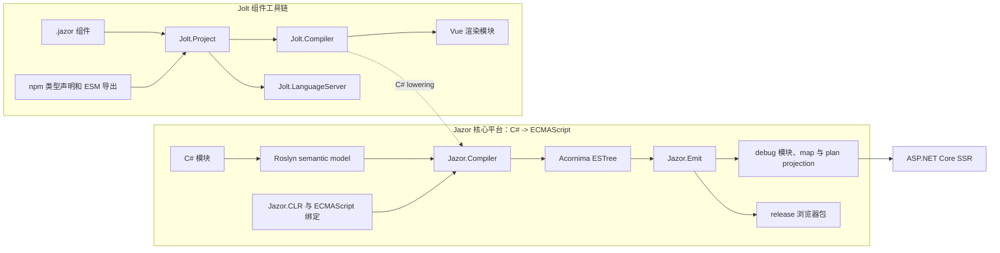

# 系统架构

> 本页说明 Jazor 从作者代码到浏览器产物的当前生产链路，以及每个模块应当止步的位置。

## 主链路

C# 模块与 Jolt 的 `.jazor` 组件共享 Roslyn 语义和核心编译器。

## 职责边界

链路能够保持可验证，依赖于每一层只完成自己的职责。

| 层 | 责任 | 责任边界 |
| --- | --- | --- |
| Roslyn | 绑定 C# 符号并提供语义诊断 | 生成 JavaScript 或浏览器资源 |
| `Jazor.Compiler` | 降低 `IOperation`，产出 ESTree；维护导入、临时名、源位置和宿主映射 | 解析组件模板、写入文件或运行开发服务器 |
| Jolt | 绑定 `.jazor` 模板和 npm 组件，生成 Vue 渲染模块，向编辑器提供语义信息 | 重新实现 C# 表达式和成员语义 |
| `Jazor.Emit` | 读取 `ModuleCatalog` 与 JS resource manifest，解析显式依赖闭包、物化标准项目模块/源映射/资源并调用项目配置的 JavaScript 构建工具 | 决定 C# lowering 规则 |
| ASP.NET Core 集成 | 承载静态资源、SSR 与 hydration | 替代浏览器打包器或编译器 |

## 核心约束

以下约束保证新增能力沿用既有的语义与交付边界。

1. C# 语义经由 Roslyn 与 `Jazor.Compiler` 的正式翻译入口转换为 ECMAScript，是 Jazor 核心的职责。
2. Jolt 构建和语言服务共享项目配置、组件声明和 npm 依赖输入。
3. Jolt 负责模板与 Vue 渲染结构，C# lowering 由核心编译器完成。
4. 宿主 API 由白名单和映射定义；映射缺失的运行时语义在使用点报告明确诊断。
5. 模块名称、导入别名、临时变量和源映射锚点必须保持确定性；产物物化与打包属于 `Jazor.Emit`。

组件编写见 [Jolt 作者指南](../03-guides/jolt-authoring.md)。核心与交付层见 [编译器](../02-architecture/compiler.md) 和 [产物管线](../02-architecture/artifact-pipeline.md)。
