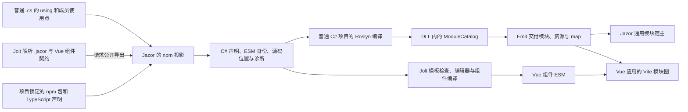

# Jazor 模块工具链与 Jolt Vue 工具的职责设定

本文记录已确定的产品分工和拟实施的技术契约。现有 SDK 的用法见[配置指南](../03-guides/installation-and-configuration.md)。代码迁移、验收与待审计项见[调整方案](../04-roadmap/jazor-jolt-migration.md)。

## 产品与入口

Jazor 用户可以只交付一个 ES module 类库。项目引用 Jazor、编写普通 C#，即可编译模块、使用通用模块开发与运行支持。Jolt 面向 Vue 应用和组件库，负责 Vue 作者体验和前端开发会话。一个 Vue 应用可以同时使用普通 Jazor 类库、`.jazor`、Vue SFC、TSX 和 npm 包。

| 用户动作 | 目标责任方 | 可观察结果 |
| --- | --- | --- |
| 在普通 C# 中引用 npm 函数、类型或常量 | Jazor 的 Roslyn 投影工具链 | IDE 能发现成员，Roslyn 检查参数与返回类型，干净检出第一次构建就能产生带原始 ESM 导入的模块 |
| 编译、引用或运行普通 C# 模块 | .NET SDK、Jazor.Compiler、Emit 和通用模块宿主 | 类库的 DLL 携带模块。最终宿主消费依赖、写出模块及 map，按已有宿主契约运行或发布 |
| 编写 Vue 组件或从 SFC、TSX 使用它 | Jolt 编译器和语言服务 | 获取 Vue 组件契约、模板诊断、渲染模块、类型声明与源位置 |
| 启动 Vue 应用并编辑页面 | Jolt | CLI 和 IDE 启动同一种开发会话。每个运行中的应用实例使用一个 Vite 服务与一条浏览器 HMR 通道 |
| 构建并发布 Vue 应用 | Jolt 编排组件编译与 Vite 打包，宿主或部署工具发布 | 独立前端交付 Vite 产物；ASP.NET Core 的发布步骤收集同一次构建的 SPA 或 SSR 产物 |

当前源码中，普通类库在 `.cs` 中使用 `using`，组件在 `.jazor` 中使用 `@using`。两端共享 Jazor 的 npm 值投影。旧版的 `jolt bindings` 已移除。普通 `.cs` 通过 SDK 接入构建，编辑中的导入和成员请求由 Jazor 的 Roslyn 编辑器组件接收。[SDK 构建入口](../../src/Jazor/build/Jazor.Npm.targets) · [Jolt CLI](../../src/Jolt.Cli/Program.cs)

## 投影由谁生成，Jolt 读取什么



箭头表示数据流。代码依赖从 Jolt 指向 Jazor。Jazor 的通用投影、分析、编译和模块运行路径可以在缺少 Jolt、Vue 类型程序集和 Vue 前端工具的环境中加载。TypeScript checker 负责解开真实声明、泛型、重载和重导出；Jazor 决定对应 C# 契约与值传递规则；Roslyn 完成作者调用的符号绑定。详细的类型算法沿用[投影与值传递规范](./npm-projection-rules.md)和[编译器实现原则](../../src/Jazor.Compiler/ImplementationPrinciples.md)。

| 输入 | 如何处理 | 交付给使用方 |
| --- | --- | --- |
| 项目依赖、锁文件、模块 specifier、实际请求的导出 | 按包的公开 exports、子路径、条件及声明身份解析，保留作者的运行时导入路径 | 可补全的导出名、选中导出的精确签名、实际读取的依赖和定义位置 |
| 普通对象、泛型回调、联合、可选成员、数组、日期或浏览器类型 | 用已有 Jazor / ECMAScript 表示及转移规则。保留对象身份、求值次数和顺序、参数方向，以及缺席、显式 null 和 undefined 的区别 | 编译用 C# 声明、公开 DLL 可携带的宿主映射、属性与回调约定 |
| 声明确实引用 Vue 的 `Ref<T>`、computed 或插件契约 | 依据解析后的声明身份和项目引用的 Vue 契约，映射到已有手写类型。普通记录与字典先检查通用表示 | 使用方在普通 C# 中也能获得 Vue 的读写约束；未引用所需契约时在使用处提示依赖 |
| Vue 组件标签、props、emits、slots、本地 SFC 与模板范围 | Jolt 解释 Vue 语义和模板位置；其中的通用参数、回调和返回类型消费同一份投影结果 | Vue 组件契约、模板诊断、跳转、渲染与 HMR 所需信息 |

Vue、Vue Router、Pinia、Pinia Testing、Vue Devtools 继续提供手写绑定。date-fns、VueUse、Floating UI、VeeValidate、Vue I18n、Vue Query、Monaco 提供参考调用与真实运行数据。新增规则按声明结构、宿主身份及 Jazor 转移语义表达；再用一个不同包名或本地等价声明验证同一条规则。Vue 包向编译器提供已认可的私有字段存储策略，普通 Jazor 类库沿用既有字段语义。[Vue 包的内部传递](../../src/ECMAScript.Vue/buildTransitive/ECMAScript.Vue.targets) · [七库语料](../04-roadmap/p3-vue-application-bindings-plan.md)

## 作者体验与工程输入

项目在 `package.json` 中声明 `date-fns` 并由 `pnpm-lock.yaml` 锁定版本后，普通 C# 类库和 Jolt 组件可分别这样使用它。

```csharp
using ECMAScript;
using Dates = Npm.DateFns.Exports;

[ECMAScriptModule("calendar.mjs")]
public static class Calendar
{
    public static Date Tomorrow(Date today) => Dates.AddDays(today, 1);
}
```

```razor
@using Dates = Npm.DateFns.Exports

<output>@(Dates.AddDays(Start, 1).GetDate())</output>

@code {
    [Parameter] public ECMAScript.Date Start { get; set; } = new ECMAScript.Date(2026, 0, 15);
}
```

两端都能导入 `date-fns` 的 `addDays`。在普通 C# 中将第二个参数改为 `true`，Roslyn 可在原调用位置报告 `CS1503`。编辑器从包描述发现依赖名，从值导出索引补全 `Dates.`，按实际使用的成员展开签名。Roslyn 的 Automatic 设置会在编辑时重新运行生成器。Balanced 可能保留上次生成的成员，直到保存或构建。[普通 C# 冷构建与运行](../../scripts/csharp/verify-jazor-npm-projection.cs) · [组件用例](../../scripts/csharp/fixtures/jolt-npm-runtime/App.jazor)

C# 的 `using` 指令没有特性（attribute）位置，`.jazor` 的 `@using` 也按 C# 导入语法解析。`Dates` 是作者可自选的局部别名。普通类库生成的 `AddDays` 成员携带 `[ECMAScript("date-fns")]` 和 `[ECMAScriptName("addDays")]`，编译器据此保留 npm 模块和导出名。[Jolt 导入解析](../../src/Jolt.Compiler/JoltProjectImports.cs) · [生成成员元数据](../../src/Jazor.Npm/NpmValueProjection.cs)

**工程归属。** 建议普通项目以参与编译的 `.csproj` 所在目录为起点，按项目实际的包与锁文件解析 workspace；Jolt 将已有的前端工程根传给投影层。链接进项目的 `.cs` 文件按消费它的工程解析。相同的 C# 命名空间若匹配多个公开 specifier，在导入处列出冲突；绝对路径、遍历顺序和包名猜测都不能决定绑定。多工程布局确需新的公开选择方式时单独审计。

**诊断归属。** 包缺失或没有公开子路径时，在导入处给出实际解析的工程与模块。声明形状无法投影时，在使用点给出成员、具体参数或返回类型路径和原始声明位置。只在类型位置出现的导出随 C# 类型传递，索引和补全不产生 JS import。参数类型不匹配交给 Roslyn，Jolt 将对应跨度映回模板。声明不确定时保留诊断，避免把整段调用放宽为 `object` 后误报成功。

**生成时序。** SDK 把已求值的 C# 源文件、引用、语言版本和条件编译符号交给 Jazor。Roslyn 绑定使用点，Jazor 读取命中的 npm 导出，SDK 将生成结果加入本次 `Compile`。随后 `ESGenerator` 从已绑定的调用生成 ESM。Jolt 把同一引擎产生的声明树加入组件 compilation，并将位置映回组件。普通 C# 编辑器把当前 Roslyn compilation 交给同一发现器。设计时组件通过项目自身的 analyzer 引用加载，给 workspace 生成声明。命令行构建从磁盘独立生成本次编译的输入。[SDK 使用点发现](../../src/Jazor.Npm/NpmSourceRequests.cs) · [ESGenerator](../../src/Jazor.Compiler/ESGenerator.cs) · [Jolt compilation](../../src/Jolt.Compiler/JoltProjectCompiler.cs)

**命名类型的选择。** 当前从被选中值的签名展开命名记录。例如契约类库用 `nameof` 选出操作该记录的导出，生产者与消费者即可在 C# 参数和返回值中使用同一类型。仅公开为 TypeScript `export type` 或 `interface`、未出现在任何所选值签名中的独立声明，目前没有普通 C# 导入入口。[跨 DLL 的代码示例](../03-guides/jolt-authoring.md#在多个-dll-之间传递同一条-npm-记录)

**运行位置。** Roslyn 负责语法、符号和设计时快照。npm 包解析和 TypeScript checker 在 Jazor 的 NodeApi 工具宿主内执行。编辑器按项目 SDK 已求值的 `NetCoreRoot` 启动该宿主，Windows 使用选定构建的 `CETCompat=false` apphost。这样，运行在 Visual Studio 私有 .NET 10 上的 Roslyn 也能启动项目的 .NET 11 投影工具。本机 TypeScript 链接只写入编辑器投影，重导出的位置指向实际声明。[未保存源码验收](../../scripts/csharp/verify-jazor-npm-editor.cs) · [工具链约定](../03-guides/toolchain-migration.md)

**F12 定义导航。** Windows 上的 Roslyn 5.13 C# LSP 对普通 `.cs` 调用返回 `roslyn-source-generated:` URI 和生成 C# 的标识符范围，调用处的悬停链接指向实际的 `.d.ts` 声明。隔离的源生成器加入带列范围的 `#line` 后，F12 仍定位到生成文件。`.jazor` 由 Jolt LSP 处理定义请求，直接用已绑定的 npm 符号和投影位置索引返回原始声明。[普通 C# 验收](../../scripts/csharp/verify-jazor-npm-editor.cs) · [Jolt 定义处理](../../src/Jolt.LanguageServer/LanguageFeatures.cs)

**桌面 C# 悬停。** Visual Studio 2026 Insiders 的 Quick Info 会把 XML 文档中的 `file:` URI 显示成链接。该版本的 `VisualStudioNavigateToLinkService.TryNavigateToLinkAsync` 只将 HTTP(S) URL 交给系统浏览器。桌面打开本机文件与定位光标由 Jazor 的 C# 编辑器组件处理，随原有 `Jolt.VisualStudio.vsix` 一次安装。它从已绑定的 C# 符号读取 Jazor 生成的声明位置。`.jazor` 继续使用同一安装包中的 Jolt 语言客户端。[VSIX 清单](../../editors/jolt-visual-studio/source.extension.vsixmanifest) · [候选版验收](../04-roadmap/jazor-jolt-migration.md)

- **普通 C# 随包交付。** 本机 Roslyn 5.13 的 `ISpanMappingService`、`ISourceGeneratedDocumentSpanMappingService`、`IDefinitionLocationService` 和定义请求处理器均为内部类型。源生成文档映射是工作区宿主服务。现有 NuGet analyzer 可通过公开的 `ExportCompletionProviderAttribute` 提供补全，已检查的定义和映射接口没有对应的公开 analyzer 注册入口。若目标宿主后续公开支持定义结果映射，再用已有索引验证重导出、不同重载、UTF-16 位置、未保存缓冲区、声明刷新及普通 C# F12。[Roslyn 生成文档映射接口](https://github.com/dotnet/roslyn/blob/main/src/Workspaces/Core/Portable/Workspace/Host/DocumentService/ISourceGeneratedDocumentSpanMappingService.cs)
- **VS Code 客户端接入。** 公开的 `registerDefinitionProvider` 可以增加原始声明位置。VS Code 并行调用匹配的提供者并合并结果，原始声明和 C# 提供者返回的生成声明会一起参与多目标处理。普通 F12 独占重定向需要 C# 提供者或其语言客户端有受支持的结果重写入口，目前未验证到该入口。单独命令可以将原始声明作为唯一目标，需要客户端接入。[VS Code 定义提供者契约](https://github.com/microsoft/vscode/blob/main/src/vscode-dts/vscode.d.ts)

**DLL 边界。** 公开投影保留实际 specifier、导出名和成员语义。若多个 DLL 的公开签名需要传递同一个 npm 命名记录，由一个普通类库生成该记录及相关导出，其他类库通过程序集引用复用。已有的全局可见 `Exports` 由 Roslyn 绑定其成员。仅通过 `extern alias` 可见的类型处在对应别名的作用域，消费者仍可在全局命名空间投影 npm 包。各自编译出同名记录的两个程序集具有不同类型身份，迁移到共享定义需重编译依赖方。运行时由调用点的 ESM 导入 npm 函数。只选择声明且未标注模块的契约项目可以不携带 JavaScript catalog。[普通类库与独立 DLL 验收](../../scripts/csharp/verify-jazor-npm-library.cs) · [类库交付契约](./library-artifact-contract.md)

## 结构稳定的投影缓存

声明缓存记录 TypeScript 实际读取的文件、重导出和链接目标。生成代码缓存按排序后的导出、类型结构、声明身份和工具版本寻址。普通 C# 使用公开宿主声明，组件还需要模板定义位置和调用绑定，两种输出分别缓存并共用生成规则。内容相同的普通项目生成文件保留时间戳。纯 npm 投影的缓存键不加载 Vue 程序集。[声明缓存](../../src/Jazor.Npm/NpmValueMetadataProvider.Cache.cs) · [生成代码缓存](../../src/Jazor.Npm/NpmProjectionCache.cs)

| 变化 | 缓存应如何响应 |
| --- | --- |
| 使用点换序、重复导入、不同机器的绝对路径、编辑模板文案 | 同一导出集产生稳定成员名、顺序和代码字节。单独更新作者位置；内容相同的已生成代码保留时间戳 |
| 锁文件、解析条件、实际读取的 `.d.ts` 或链接目标变化 | 重新确认受影响的声明图。签名内容一致可复用代码，声明位置变动须更新导航。未引用的包不应使整个工程重新投影 |
| 编译器、类型转移规则或实际使用的宿主契约变化 | 相应投影失效。纯 npm 标量和普通记录的缓存键无需装载 Vue 类型。不同包版本、工程引用和条件需要隔离 |
| IDE 与构建并发、生成取消或中途失败 | 读者只能读到同一代的源码和索引；成功才发布完整结果。保留上次成功缓存供恢复，本次失败的构建仍返回诊断 |

### 供独立消费者直读的用户级缓存（评估中）

普通 C# 项目与 Jolt 可以遵循同一份磁盘协议。Jazor 拥有规则、生成、失效处理和写入。Jolt 命中时可在进程内读出签名与声明索引，冷启动或临时增加依赖时可请求随工具交付的 Jazor 投影器。共享读取代码属于实现选择。这个设计允许 IDE 在首次构建前取得类型，也允许同一用户的两个独立项目复用解析结果。当前实现仍使用项目目录。

直读需要在运行 TypeScript checker **之前**定位条目。例如请求一个包的子路径导出时，用已解析的包内容身份、影响声明的依赖和 peer、入口条件以及映射规则版本查得该导出签名及其可达类型。发布方还需要提供包内相对声明位置，读者用当前安装目录恢复 F12 目标。重载和类型共有的声明应保留身份。`link:` 与 `workspace:` 的输入可在版本不变时编辑，其内容必须重新验证。项目本次选择的成员、未保存的模板以及当前 Roslyn 符号仍随项目绑定。

在已有项目缓存上做了跨工具对照。普通 C# 只调用锁定的 date-fns 4.4.0 的 `AddDays`，随后由同一 npm 项目根下的纯值组件调用相同导出。两个工具使用相同的 Jazor.Npm 程序集和预热的 pnpm 内容存储。C# 首次构建记录 3 次 `ts.createProgram`，Jolt 在该目录首次构建记录 0 次。在另一个独立 npm 项目目录首次运行相同 Jolt 组件时，包下载量为 0，仍记录 3 次 `ts.createProgram`，原地重建降至 0。[计数点与采样方法](../../samples/Jolt.Mixed/EditFeedback-baseline.md#在隔离源码副本计数-checker-与-vite)

用户级方案的验收目标是让第二个项目在声明环境相同时也获得相同类型与诊断、F12 定位到自己的安装目录，且该导出不再启动 checker。用不同 peer 和改变声明的链接包验证失效，再比较独立项目首次补全的实际耗时。

## Dev、运行与发布

| 操作 | 由谁实际执行 | 交接点 |
| --- | --- | --- |
| 单独开发一个通用 ES module | Jazor 开发与运行支持 | 读取模块、依赖和 map，报告构建或运行错误。这个场景可完全脱离 Vue 和 Jolt |
| 修改 `.jazor` 模板 | Jolt 重新编译受影响的组件，Jolt 管理的 Vite 会话发送更新 | 兼容的模板变化重渲染并保留状态；实例结构变化按 Vue 的重载边界处理 |
| 修改应用引用的普通 `.cs` | .NET SDK 构建改变的类库，Jazor 刷新 catalog，Emit 更新该应用消费的 ESM | Jolt 的 Vite 观察真实模块输出。只监听可执行输出，排除投影和工具临时文件；一次保存只触发一轮有效更新 |
| 从命令行或 ASP.NET Core F5 启动 Vue 开发 | Jolt 创建会话。ASP.NET Core 可发起启动或连接已有 Jolt 会话，并代理 HTTP/WebSocket | 会话所有者负责取消、退出与释放端口。连接已有会话的宿主退出时释放自己的代理，外部会话继续服务 |
| Vue SPA 或 SSR 生产构建 | Jolt 编译一次组件并调用应用的 Vite 配置生成客户端和适用的服务端产物；宿主负责交付 | 应用拥有入口、包描述、锁文件。发布直接收集前端产物；启用 SSR 时验证请求级渲染、hydration 和资源路径 |

Emit 继续拥有 DLL catalog 与资源清单到模块、map 和资源的物化。Vue 前端消费这项能力时，需要的是一组可导入、可观察的模块；应用自己的入口与锁文件已有明确所有者。通用 NodeApi 承载模块装载、进程内 JS 执行和生命周期，Vue SFC 插件、组件热更新决策和 Vue 专用构建参数由 Jolt 负责。ASP.NET Core 负责宿主生命周期和 HTTP 边界。源码包、运行时装载器与开发服务器分别验证，不能以“浏览器成功打开一次”代替热更新或关闭会话的证明。[当前 Vite 集成](../../src/Jolt.Vite/JoltViteToolchain.cs) · [ASP.NET Core 开发宿主](../../src/Jazor.AspNetCore.Dev/JazorViteDevelopmentServer.cs)

## 宿主公共契约

同一份模块 DLL 可以同时供独立 Jazor 宿主和 Jolt 应用使用。独立宿主从程序集依赖闭包还原 npm 身份，Jolt 在自己管理的 Vite 模块图中从应用根解析这些已登记的导入。应用与 DLL 因而可以共享同一个包实例，类库中的 CLR 相对导入仍由 Emit 交付。[类库产物契约](./library-artifact-contract.md) · [包引用验收](../../scripts/csharp/verify-jazor-module-handoff.cs)

沿用 `JazorMode` 的原定义。普通 MSBuild 构建留空时按 `none` 处理，类库在 DLL 内交付 catalog。最终可执行宿主可显式选择 `debug` 或 `release`。`JazorDir` 只指定目录，默认是项目下的 `jazor/`。直接调用 Emit CLI 省略 `--mode` 默认走开发构建，`development` 与 `production` 仍是 `debug` 与 `release` 的 CLI 别名。这些行为与 Vue 会话选择相互独立。[SDK targets](../../src/Jazor/build/Jazor.targets) · [SDK props](../../src/Jazor/build/Jazor.props) · [Emit 参数](../../src/Jazor.Emit/EmitOptions.cs)

已确认移除 `jolt bindings`，普通 C# 采用 F12 到生成声明与悬停到原始声明两个入口。宿主启动 Vue 开发会话时可使用 `jolt dev --stop-on-stdin-close` 传递会话生命周期。其余新增公开属性、命令、包、宿主注册方法、跨程序集契约变化以及 Vue 项目接管 F5 默认入口，按具体调用示例、对现有用户的影响和验收证据单独审计。[调整方案](../04-roadmap/jazor-jolt-migration.md)
