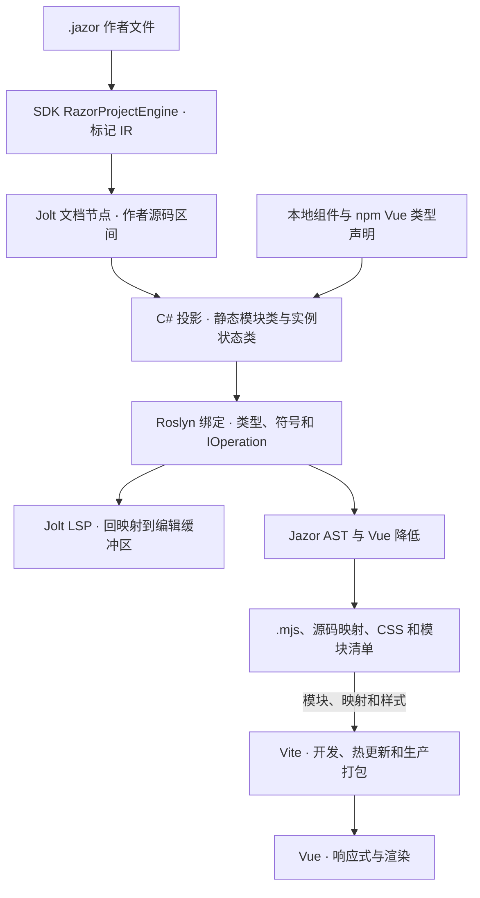

# Jolt 作者模型、目标特性与语法审计

## 产品目标

希望 Vue 团队能在现有 Vite 应用里把一个表单、列表或设计系统组件写成 `.jazor`。熟悉 Razor 的作者可以直接用 C# 写控制流、绑定和模板，Vue 作者可以照常使用 npm 组件、组合式函数、插槽和开发工具，库的消费者可以从 Vue SFC 或 Vue TSX 调用同一个组件。下文列出目标语法与示例。现状审计先列工作区已实现的五批能力，随后保留已发布的 `v2.2.0` 逐项对照。 [现状审计](#现状审计) · [下一阶段开发计划](../04-roadmap/next-development.md#jolt-开发顺序)

“超越 Vue SFC”优先体现为三项可验证的作者能力。第一，在一个列表模板内用 C# 模式匹配、局部变量、泛型和具名片段表达业务规则。第二，同一份组件契约同时检查 C# 调用方和 Vue/TS 调用方，改错能定位到作者文件或 npm 的公开声明。第三，已有 C# 纯函数和 npm 模块能在同一个组件中按需导入。运行性能单独用功能等价的生产 SFC 做对照。

## 目标特性与写法

组件和普通 C# 类库共用 npm 投影算法。泛型如何从参数传到回调和返回值、哪些宿主类型直接复用，以及生成代码如何缓存，见 [npm 类型投影与值传递规范](./npm-projection-rules.md)。

### Razor 和 Blazor 的作者面

| 作者要做的事 | 目标写法举例 | 现状与设计决定 |
| --- | --- | --- |
| 输出文本、属性和多个相邻节点 | `@name`、`@(price * count)`、`class="row-@index"`、`@@`、`@* 注释 *@`、`<text>`、`@:` | 保留现有 Razor 入口。测试相邻文本与空白、多根和条件分支，不引入可见的包裹元素。 |
| 写带标记的 C# 语句 | `@{ var page = pages[i]; }`、`@for`、`@switch`、`case … when …`、`break`、`continue` | 在现有 `@if` / `@foreach` 上补齐常用控制流，再扩展 `@while`、`@do` 和带标记的 `@try` / `catch` / `finally`。保留局部作用域、退出目标和求值次数。模板同步产生 VNode，异步取数放到事件、setup 或 SSR 钩子。 |
| 管理 C# 语句中的资源 | `@using (var scope = OpenScope()) { … }`、`@lock (gate) { … }` | 资源语句与导入指令分别解析。前者仅在核心支持相应释放协议时开放，保证退出与异常时各释放一次。涉及锁或跨线程同步的标记暂缓，须先定义可观察的宿主行为。 |
| 组织跨文件的组件和 C# | `@using App.Shared`、`@namespace Shop.Orders`、`_Imports.jazor`、`OrderRowState.cs` | 目录共享导入由外向内应用。组件在 `@code` 声明实例成员，跨文件状态和 DTO 用普通 C# 类型，通过字段、参数或方法显式引用。 |
| 声明可检查的参数和泛型 | `[Parameter, EditorRequired]`、`@typeparam TItem where TItem : IRow`、再声明 `@typeparam TKey` | 保留已有必填参数、默认值和单参数推断。补多参数、约束及明确传参，静态检查后擦除。级联泛型按祖先契约传播，不能确定就让作者指定类型。 |
| 控制节点身份、引用和透传 | `<li @key="row.Id">`、`<input @ref="searchBox" />`、`<button @attributes="attrs">` | 现有普通 `key` 能传给 Vue。目标让 `@key` 使用同一 VNode key；DOM ref 挂载后赋值，卸载时清空，组件 ref 仅暴露声明的实例 API。展开按书写顺序求值，普通同名属性后者优先，class、style 和监听器按 Vue 合并规则处理。 |
| 收取 DOM 事件 | `@onkeydown="HandleKey"`、`@onsubmit:preventDefault="true"`、`@onclick:stopPropagation="enabled"` | 从现有无参委托扩展到 WebIDL 事件参数、无参或有参的异步处理器。修饰符在事件发生时生效，拒绝无效组合。阻止传播按浏览器事件范围执行；Vue 接收返回的 Promise 并沿其错误处理路径传播。 |
| 编辑表单及组件模型 | `@bind="name"`、`@bind:event="oninput"`、`@bind:get="name" @bind:set="SetName"`、`@bind:after="Refresh"`、`@bind-Open="open"` | 先交付字符串和布尔勾选，再处理 radio、select、多选、数值及可空值；日期格式和 culture 需有明确的解析规则。`:after` 在成功写回后运行一次。组件依 prop 与更新事件配对，调用点检查可写性和双向类型。 |
| 复用模板、子内容和插槽 | `<slot name="item" value="@row" />`、`<template #item context="s">@s.value</template>`、`RenderFragment<string> Label = name => @<strong>@name</strong>;` | 前两种沿用现有入口。目标补可传递的惰性模板、类型化 render prop，以及有契约时的 Blazor 具名子内容写法。调用方捕获局部变量，消费方传入上下文，每次调用产生独立的 VNode。 |
| 影响组件类、空白或元数据 | `@preservewhitespace true`、`@implements ISelectable`、`@attribute [Example]`、`@inherits RowBase` | 空白规则由 Syntax 明确应用。接口和编译期特性进入 Roslyn 投影；每个有运行意义的特性须有消费方。继承等到同一组件状态类型、基类来源及初始化顺序都能由 Jazor 保真时再开放。当前静默丢弃的指令须在原位置给出诊断。 |
| 取应用服务、路由、布局 | `@inject ITheme Theme`、`@page "/orders/{id:int}"`、`@layout OrdersLayout` | 放在可选 Vue 集成。注入由 setup 使用显式 typed key 匹配 provider；路由由 Router 适配器生成记录并验证参数转换；布局通过 Vue 嵌套视图或 slot 组合。适配器缺失时在指令处说明所需能力。 |
| 指定服务器行为 | `@rendermode InteractiveServer`、`@formname`、`[SupplyParameterFromForm]`、`@attribute [StreamRendering]` | 属于宿主行为。应用可以交付 Vue SSR、表单提交或流式响应，各自有独立验收。Blazor circuit、服务器表单分派和 MVC/Razor Pages 专属的 `@model`、`@section`、Tag Helper 指令在组件模式提供明确诊断。 |

Blazor 组件库中的常用能力也应有迁移路径。祖先共享主题或表单上下文可用 typed provide/inject 表达 `CascadingValue` / `[CascadingParameter]` 的需求。异步的 `EventCallback<T>` 用可等待的 typed handler 表达。表单校验先用原生约束或 VeeValidate，长列表先用已有 npm 虚拟列表组件。只有调用方确实需要 Blazor 的特定协议时才评估对应适配器。 [Blazor 级联值](https://learn.microsoft.com/en-us/aspnet/core/blazor/components/cascading-values-and-parameters) · [仓库的 Vue 应用绑定](../04-roadmap/p3-vue-application-bindings-plan.md)

[Razor 语法](https://learn.microsoft.com/en-us/aspnet/core/mvc/views/razor) · [Blazor 模板组件](https://learn.microsoft.com/en-us/aspnet/core/blazor/components/templated-components) · [Blazor 数据绑定](https://learn.microsoft.com/en-us/aspnet/core/blazor/components/data-binding) · [Blazor 事件](https://learn.microsoft.com/en-us/aspnet/core/blazor/components/event-handling) · [Vue 渲染函数](https://vuejs.org/guide/extras/render-function.html)

**目标示例 · 可编辑的折叠面板**。文本框沿用 Blazor 默认的 `change` 事件，这里显式选择每次输入时更新。中文输入法组合期间推迟写回，勾选框则读取 `checked`。Reka UI 的触发器和本页的勾选框共同控制同一个 `bool`。

```razor
@using Npm.RekaUi

<label>筛选 <input @bind="filter" @bind:event="oninput" /></label>
<label><input type="checkbox" @bind="open" /> 展开详情</label>
<CollapsibleRoot @bind-Open="open">
    <CollapsibleTrigger>详情</CollapsibleTrigger>
    <CollapsibleContent>@filter</CollapsibleContent>
</CollapsibleRoot>

@code {
    private string filter = "";
    private bool open;
}
```

同一个 `@bind` 在 DOM 元素上读写控件，在组件上查**公开契约**。上例从 Reka UI 声明取得实际 prop `open` 和事件 `update:open`，产物使用 `onUpdate:open`。把 `filter` 错绑给 `Open` 会在该属性报类型错误。对本地组件，工作区已将 `[Parameter] T Value` 和 `[Parameter] Action<T> ValueChanged` 识别成一对，对 Vue 调用方公开 `value` / `update:value`。显式传入 `ValueChanged` 的既有调用仍只走该委托一次。默认的 Vue `v-model` 对应 `ModelValue` / `ModelValueChanged`。普通回调作为函数 prop。 [Reka UI Collapsible](https://reka-ui.com/docs/components/collapsible) · [Vue 组件 v-model](https://vuejs.org/guide/components/v-model.html)

**目标示例 · 在标记中使用 C# 局部变量和模式匹配**。每次 render 对每行调用一次 `Describe`；调换行顺序后，有焦点的输入框仍跟随同一业务 ID。

```razor
<ul>
    @foreach (var row in Rows)
    {
        var label = Describe(row);
        <li @key="row.Id">
            @switch (row.Quantity)
            {
                case <= 0:
                    <em>@label 缺货</em>
                    break;
                default:
                    <label>@label <input value="@row.Quantity" /></label>
                    break;
            }
        </li>
    }
</ul>

@code {
    public record Row(int Id, string Name, int Quantity);
    [Parameter] public Row[] Rows { get; set; } = [];
    private string Describe(Row row) => row.Name;
}
```

### Vue SFC 与 TSX 的组合能力

| 能力 | 目标作者入口 | 行为和边界 |
| --- | --- | --- |
| 条件、重复、显示和动态属性 | 继续用 `@if`、`@foreach`、`class="@classes"`、`style="@styles"`；增加 `<aside v-show="@open">` | 同一个业务表达式只写 C#。保留 `v-show` 隐藏时的实例和 DOM 身份。对 `v-if`、`v-for`、`{{ … }}` 等容易被当成文本的 Vue 模板输入，在可判明为指令时提供 Razor 改写提示，保留有意书写字面文本的途径。 |
| 组合式 API、状态与生命周期 | 工作区的 `[Setup] private void Configure()` 可同步调用 composable 与 `Vue.Watch(...)` 等宿主绑定 | 每个实例在 live props、slots 就绪后执行一次。Vue 管理 watcher 和清理，模板读取响应式值。混合 SSR 应用通过请求级工厂创建 Vue app、router、store，服务端完成预取后把状态交给客户端。 |
| 公共实例、依赖注入、插件 | 提议 `[Expose] public void Focus()`；setup 中使用 `Vue.Provide(key, value)` / `Vue.Inject(key)`；入口中使用 `app.use(router)`、`app.use(pinia)` | 分别对应 SFC 的 `defineExpose`、实例依赖和应用插件。仅向 ref 的声明输出公开成员，实例方法与 ESM 具名导出各有作用域。应用选择 Router、Pinia、i18n 和查询库。 |
| TSX 风格的组合和动态组件 | 泛型 prop、回调、render prop、多个根、`<component is="@selected" />`、`@attributes` | 让 C# 表达式选择已绑定的组件值，Roslyn 检查共同 props 或经分支收窄的具体契约。回调/插槽在使用处检查参数和返回类型。SFC 或 Vue TSX 从生成的声明取得同一契约。 |
| Vue 运行时组件与指令 | `<Teleport to="#overlays">`、`<Transition>`、`<TransitionGroup>`、`<KeepAlive>`；按包导入 typed 自定义 directive | 标签须绑定到实际 Vue 导出，保留插槽、生命周期、key 的要求。自定义指令按契约绑定值并交给 `withDirectives`。异步组件与 `Suspense` 待异步 setup、错误传播和 SSR 有验收后开放。 |
| CSS 与资源 | 已有顶层全局 `<style>` 和 `<style scoped>`，目标补 `<style src="./row.css">`、`:deep()`、CSS Modules 和模块类名补全 | Vite 与 Vue 样式编译器负责选择器、资源 URL、预处理器和 CSS HMR。响应式 CSS 值映射为 CSS 自定义属性，C# 值进入 Roslyn；SSR 首屏与客户端使用同一 scope ID。 |
| 显式 HTML、静态内容与缓存 | 文本用 `@text`；原始 HTML 仅通过明确的标记值入口；纯静态子树由编译器识别 | `v-text` 已有文本表达式等价写法。`v-html` 对应显式 HTML 输入，子内容互斥。`v-once` / `v-memo` 待基准确认需要后再提作者入口。`v-pre` / `v-cloak` 属于运行时模板场景，预编译组件用字面量和应用启动样式满足对应需求。 |

[Vue SFC 编译宏](https://vuejs.org/api/sfc-script-setup.html) · [Vue 内建指令](https://vuejs.org/api/built-in-directives.html) · [Vue JSX 与插槽](https://vuejs.org/guide/extras/render-function.html) · [SFC CSS](https://vuejs.org/api/sfc-css-features.html) · [Vue 的 C# 生命周期绑定](../../src/ECMAScript.Vue/Api/Vue.Api.Lifecycle.cs)

**示例 · 在实例挂载后聚焦输入框**。工作区提供 `[Setup]`，`Vue.OnMounted` 和 `HTMLInputElement` 使用仓库已有的宿主绑定。setup 在 DOM 创建前注册回调，挂载后 Vue 填充 ref，条件移除元素或卸载时清空 ref。

```razor
@using ECMAScript

<input @ref="searchBox" />

@code {
    private HTMLInputElement? searchBox;

    [Setup]
    private void Configure() => Vue.OnMounted(() => searchBox?.Focus());
}
```

### 在 Vue 项目里直接复用代码

| 来源 → 调用方 | 作者写什么 | 构建或运行时由谁负责 |
| --- | --- | --- |
| npm Vue 组件 → `.jazor` | 已有 `@using Npm.RekaUi` 和标签。目标把 model、emits、slot 参数、泛型和 exposed ref 纳入同一份组件契约 | 从消费者锁定版本的公开 ESM 导出和声明取证。构建期的 TypeScript checker 提供类型和定义位置，浏览器从原包导入组件。 |
| npm 函数 / 常量 → C# | 通过别名引入公开子路径的 `Exports`，例如 `Text.CamelCase(title)` | Jolt.Npm 查询 TypeScript 声明，Project 按 C# 绑定的使用点选择导出，Jazor 发射标准 ESM import。保留默认导出、具名导出和原始 specifier。 |
| npm composable → 组件实例 | 在同步 `[Setup]` 中调用 `VueUse.UseCounter(Initial)`，模板读取 `counter.Count.Value`，事件中调用 `counter.Inc()` | 返回类型包含真实的 ref 和回调。含 ref 的状态字段和自动属性保留 Vue ref 身份及读写约束，watcher 归当前组件的 effect scope。 |
| 本地 `.vue` ↔ `.jazor` | 在 SFC 或 Vue TSX 中直接 `import SearchBox from './SearchBox.jazor'`；同目录的 `SearchBox.jazor` 可以在模板里写 `<StatusBadge … />` 引用 `StatusBadge.vue` | 项目加载器识别本地组件，跨目录使用命名空间或显式别名，重名时要求消歧。Vue Language Tools 提取 SFC 的公开类型，Vue Vite 插件编译 SFC，Jolt 插件解析 `.jazor` 并提供产物与映射。两者共享应用的 Vue 实例与 Vite 依赖图。 |
| Jolt 组件库 → 普通 Vue/TS 项目 | 消费者从包的公开路径导入组件、类型及具名工具方法，像使用其他 Vue 库一样开发 | 从同一 `ComponentContract` 生成与 ESM 配套的 TS 声明，保留泛型、可选性、props/emits/slots、公开 ref 和具名成员。包声明 `exports` 的类型与运行入口、CSS 资产及 Vue peer dependency。已构建的包由常规 Vue 工具链直接消费。 |

工作区可以把同一个 `DateFns.Duration` 传给 `Add`、`Sub` 和 `FormatDuration`。在 setup 中可读写 `VueUse.UseStorage("draft", "")` 返回的 ref，或从 `VueUse.UseMouse().X.Value` 读取坐标。验证脚本从现有手写绑定提取导出清单，以新写法检查强类型调用和跨导出传值。 [日期调用示例](../03-guides/jolt-authoring.md) · [真实包运行用例](../../scripts/csharp/fixtures/jolt-npm-runtime/App.jazor) · [绑定对照验证](../../scripts/csharp/verify-jolt-binding-projection.cs)

**工作区示例 · npm 的普通函数**。项目声明 `es-toolkit` 后，可以在 `.jazor` 中直接使用它公开的字符串工具。

```razor
@using Text = Npm.EsToolkit.String.Exports

<output>@Text.CamelCase(Title)</output>

@code {
    [Parameter] public string Title { get; set; } = "Order total";
}
```

`Exports` 是构建期生成的 C# 类型。TypeScript 声明给出 `string → string`，生成模块按需导入 `es-toolkit/string` 的 `camelCase`，此例显示 `orderTotal`。传入整数时，编辑器与构建定位到调用实参。跳转定义打开当前安装版本的声明。 [es-toolkit 的 camelCase](https://es-toolkit.dev/reference/string/camelCase.html) · [npm 元数据入口与投影边界](../../src/Jolt.Npm/README.md)

**目标示例 · 两种文件共同编辑一个值**。以下是 `SearchBox.jazor`。字符串由父组件持有，输入框调用 `ModelValueChanged` 请求更新。同目录的 `StatusBadge.vue` 用 `defineProps<{ message: string }>()` 声明预览文本。

```razor
<input @bind:get="ModelValue" @bind:set="ModelValueChanged" @bind:event="oninput" />
<StatusBadge Message="@ModelValue" />

@code {
    [Parameter, EditorRequired] public string ModelValue { get; set; } = "";
    [Parameter, EditorRequired] public Action<string> ModelValueChanged { get; set; } = null!;
}
```

父组件用标准 Vue SFC 写法持有和显示输入值。

```vue
<script setup lang="ts">
import { ref } from 'vue'
import SearchBox from './SearchBox.jazor'

const query = ref('')
</script>

<template>
    <SearchBox v-model="query" />
    <output>{{ query }}</output>
</template>
```

项目内的类型服务需能解析 `.jazor` 的具体声明；一个宽泛的 `declare module '*.jazor'` 会丢失这里要检验的模型类型。集成验收应把 `query` 改成 `ref(0)` 观察 Vue 调用端的错误，再把 `StatusBadge` 的必填 prop 改名，观察 Jolt 调用端的位置。 [Vue 与 TypeScript](https://vuejs.org/guide/typescript/overview.html) · [Vite 插件 API](https://vite.dev/guide/api-plugin)

Vue TSX 调用者也可以显式传 prop 和监听器。例如在已有 `query: Ref<string>` 的 setup 中返回下面的渲染函数。生成的组件声明应检查监听器的参数类型，改为 `number` 即在调用端报错。在 Vue 和 Jolt 两端，model 的更新监听器都满足同一个必填回调，运行时只分发一次。

```tsx
return () => <SearchBox modelValue={query.value}
    {...{ 'onUpdate:modelValue': (value: string) => { query.value = value } }} />
```

### Jazor 与 Jolt 的实现边界

| 责任层 | 本轮设计分工 |
| --- | --- |
| SDK Razor 与 `Jolt.Syntax` | 继续用组件模式的 Razor 标记 IR、Roslyn tokenizer 和原始区间；扩展语句、指令属性、模板片段和恢复节点。每项新指令先保留结构、参数和修饰符的位置。未知或尚未实现的框架指令给出定点诊断，普通 HTML、Web Components 和 `data-*` 继续可用。 |
| `Jolt.Project`、`Jolt.Compiler` 投影 | Project 读取项目目录、共享 imports 和普通 C# 项目输入，解析模块并跟踪未保存的缓冲区。Projection 与 ComponentContract 统一描述本地、SFC 和 npm 组件的外部名称、值类型、事件与插槽，并生成让 Roslyn 能检查的赋值、委托和泛型调用。绑定读取、写回和订阅各有源位置。现有公开 prop 使用作者大小写，导出 Vue model 前要用旧 JS 调用方验证兼容性，并处理显式监听器与模型监听器重复的情况。 |
| `Jolt.Npm` 与现有 `ECMAScript.*` | Vue、Pinia、Vue Router、Pinia Testing 和 Vue Devtools 提供长期维护的手写契约。其他 npm 应用库按用到的导出推导，复用宿主的 Date、DOM 及 Vue ref 类型。根据真实用例补充通用的重载、闭合联合和泛型规则，保留 JS 的缺省、显式 null 和字面量约束。缺少可用声明时由类型包、项目内窄 `.d.ts` 或 typed ESM 模块提供契约。无法表达的已使用成员需要可定位的诊断。 |
| Roslyn、`Jazor.Compiler` 与 CLR/WebIDL | Roslyn 决定符号、约束、重载和可写性，SemanticWalker 在运行时敏感的使用点检查并降低 `IOperation`。闭合值域优先用原生 C# union；分支存在可赋值关系时按仓库规则保留标签。编译期擦除泛型。核心维护求值顺序、单次副作用、确定性导入和 source origin。 |
| `Jolt.Compiler` 的 VueLowering 与 Vue | Jolt 通过现有 host hooks 生成 VNode、model 监听器、slot 函数、setup 外壳与明确的 Vue helper 导入。Vue 拥有组件实例、响应式调度、DOM patch 和生命周期。带副作用的 getter、动态键和捕获循环变量的闭包均按原语义求值。 |
| `Jolt.Cli`、`Jolt.Vite`、NodeHost、LSP | CLI 继续物化组件模块、CSS、映射和清单，Vite 组合插件、HMR、资源及打包。仓库维护的还原、TS 检查和 Vite 均走进程内 NodeApi + LibNode + 固定 pnpm API，使用 `pnpm-lock.yaml`。LSP 与 CLI 共用项目图和契约，定义、改名和诊断回到作者区间。SSR/路由、服务作用域和请求状态由相应应用集成负责。 |

[Jolt 解析](../../src/Jolt.Syntax/JoltParser.cs) · [组件契约](../../src/Jolt.Compiler/ComponentContract.cs) · [Vue 降低](../../src/Jolt.Compiler/VueLowering.cs) · [Jazor 编译器实现原则](../../src/Jazor.Compiler/ImplementationPrinciples.md) · [NodeHost](../../src/Jazor.NodeHost/README.md)

## 现状审计

以下编号章节和探针保留 `v2.2.0` 的发布基线。工作区源码已接通五批能力。表格中的例子可用仓库构建的 CLI 复现。 [运行方式](../03-guides/jolt-authoring.md)

| 工作区能力 | 可直接使用的写法 | 已确定的边界 |
| --- | --- | --- |
| 控制流和模板 | `@{ var item = rows[i]; }`、`@for`、`@switch`、`case … when …`、`RenderFragment<string> label = x => @<b>@x</b>;` | Roslyn 绑定作用域和控制流。内联模板惰性生成 Vue 节点，支持无参、带类型的参数和本地组件回调。 |
| 本地泛型和插槽 | 多条 `@typeparam`、`where`、`<Row Context="row">`、`<ChildContent>` | 调用点全量推断或全量显式指定类型。跨组件转发行数据保留成员类型。同名出口的字段及类型保持一致。npm 泛型沿用已有的独立声明映射范围。 |
| 表单和事件 | `@bind`、`@bind:event`、`@bind:get` / `@bind:set`、`@bind:after`、`@bind-Value`、WebIDL 事件和修饰符 | 文本、布尔勾选、字符串 radio 与 select、多选字符串数组和可空 `double` 使用 Vue 的原生模型。npm 按声明配对，本地参数配对 `Action<T>` 更新委托。 |
| 节点身份和透传 | `@key`、`@ref`、`[Expose] public void Focus()`、`@attributes` | DOM 与本地组件支持可空单值引用。展开只接收有类型的 Vue 属性包，普通属性、class、style 和监听器依 Vue 规则合并。 |
| 共享导入和编辑 | 目录 `_Imports.jazor` 中写 `@using App.Widgets` 或 `@using Npm.RekaUi` | 导入向后代生效，具名插槽、局部和模型的补全、定义与诊断使用同一份投影。写在共享文件的错误指向该文件。 |
| 普通 npm 值与每实例 setup | `Text.CamelCase(name)`、`[Setup]`、`VueUse.UseCounter(Initial)`、`counter.Count.Value` | 从锁定版本读取公开声明。支持标量、可表达的重载、结构化值、单签名回调与 Vue ref。泛型函数和 rest 签名目前在导出处报告诊断。 |
| 本地 Vue 混编与组件库 | SFC / TSX 中 `import Editor from './Editor.jazor'`，或从 `jolt library` 生成的包导入组件 | Roslyn 与 Vue Language Tools 各自处理源语言。Jolt 生成公开声明与映射，Vite 处理 SFC、CSS 和 HMR。消费者可检查双向 model、泛型行插槽与公开实例方法。 |
| 应用组合、路由与 SSR | `<Teleport To="#overlays">`、`<Transition Name="fade">`、`<component is="@(detail ? Details : Summary)">`、`@page "/drafts/{id:int}"` 与 `@layout DraftLayout` | 有限的静态候选在各分支检查 props 与插槽。路由适配需启用 `jolt.router`，客户端与服务端共用生成的记录。每个请求独立渲染，浏览器用同一状态接管。 |

工作区样例覆盖双泛型表格、VueUse 计数器、源码混编、独立 Vue 项目安装组件包，以及生产 SSR 和 hydration。千行列表的生产对照使用同一 Chrome、Vue、Vite 和交互脚本，报告包含中位数、p95、包体积和 DOM 身份验证。 [独立 Vue 消费者](../../scripts/csharp/fixtures/jolt-library/consumer/src/App.vue) · [SSR 应用](../../samples/Jolt.Mixed.Ssr/README.md) · [千行列表对照](../../samples/Jolt.Counter/KeyedRows-baseline.md) · [路线图](../04-roadmap/next-development.md#jolt-开发顺序)

混合工程共用一份本地 Vue 组件契约。比如将 SFC 的 `limit: number` 改成 `limit: string`，编辑器会在传入整数的 `.jazor` 调用方报告 `CS1503`，修复后会清除该诊断。只改模板中的标签文字，Vite 可直接热更，同时 Jolt.Npm 可复用仍然有效的契约。同一组样例分别测量编辑到诊断、保存到 DOM 更新，并检查输入草稿、焦点和节点身份。 [混编编辑反馈](../../samples/Jolt.Mixed/EditFeedback-baseline.md)

本文对照 Jolt `.jazor`、ASP.NET Core Blazor 的 Razor Components `.razor`、Vue 3 SFC `.vue` 和使用 React 的 TypeScript JSX `.tsx`。Razor 的 MVC 视图和 Razor Pages 属于 `.cshtml`，仅在同名指令容易混淆时提及。React 提供 TSX 示例中的渲染、状态和事件语义，TypeScript 的 JSX 也可以配置为使用其他运行时。Jolt 消费同项目的 `.jazor` 和 npm 包公开的 Vue ESM 组件及类型声明，本地 `.vue` 源文件互引不在本审计范围内。 [Razor 语法](https://learn.microsoft.com/en-us/aspnet/core/mvc/views/razor) · [Vue SFC 规范](https://vuejs.org/api/sfc-spec.html) · [TypeScript JSX](https://www.typescriptlang.org/docs/handbook/jsx.html)

Jolt 以 `v2.2.0` 所在提交 `3465c236` 为源码基线。开发服务器端口另按当前工作区核对。Jolt 表格把语法接受、诊断和产物行为一起列出，上游列依据官方文档。文末列出了复现入口和验收范围。

## 1. 文件如何变成组件

| 环节 | Jolt `.jazor` | Blazor `.razor` | Vue 3 SFC `.vue` | React `.tsx` |
| --- | --- | --- | --- | --- |
| 作者视角 | 顶层标记、C# 表达式和组件成员、限定范围的 CSS 区块 | 顶层标记和 C# 组件类成员，可拆出 `.razor.cs` partial 类 | `<template>`、`<script>` 或 `<script setup>`、一个或多个 `<style>` | TypeScript 模块，组件通常是返回 JSX 的函数 |
| 编译 | Razor 标记 IR → Jolt 节点 → Roslyn C# 投影 → Jazor JavaScript AST 与 Vue 渲染调用 | Razor 生成 C# 组件类和 `BuildRenderTree` → Roslyn 编译程序集 | SFC 编译器分别处理模板、脚本和样式，构建插件组合组件模块 | JSX 经 TypeScript 或构建工具转换为 JSX 运行时调用，TypeScript 类型在运行前擦除 |
| 运行时 | Vue 的 `defineComponent`、`reactive`、`h`、`renderSlot` 和渲染器 | Blazor 的渲染树、事件调度与生命周期，执行位置由渲染模式决定 | Vue 的响应式和渲染器，模板编译器还能生成静态提升和 patch flags 等优化 | React 组件渲染、状态更新与协调，DOM 由 React DOM 管理 |
| 文件的公开接口 | 默认导出 Vue 组件，公开静态方法和字段及公开常量进入具名导出规则 | 公开 C# 组件类型、参数属性和普通 CLR 成员 | 默认导出 Vue 组件，普通 `<script>` 可补充模块级具名导出 | 标准 ESM 导出，可在同文件导出多个组件、工具和类型 |
| 应用入口 | JavaScript 导入生成的组件，用 Vue `createApp` 挂载 | 由 Blazor 应用、路由器或渲染宿主挂载组件 | 常用 `createApp`，或由 Vue 应用框架提供入口 | 常用 `createRoot`、`hydrateRoot`，或由 React 应用框架提供入口 |

[Jolt 编译入口](../../src/Jolt.Compiler/JoltProjectCompiler.cs) · [Jolt 示例入口](../../samples/Jolt.Counter/main.js) · [Blazor 组件](https://learn.microsoft.com/en-us/aspnet/core/blazor/components/) · [Vue 渲染机制](https://vuejs.org/guide/extras/rendering-mechanism.html) · [TypeScript JSX](https://www.typescriptlang.org/docs/handbook/jsx.html)

### Jolt 的实现链路



1. **加载**。CLI 和语言服务共用项目加载器。它以目录为单位发现 `.jazor`，组件名来自文件名。在 .NET 项目中，默认命名空间由项目根命名空间与相对目录组成。纯前端目录默认使用 `App`，也可以显式设置 `jolt.rootNamespace`。当前和祖先命名空间的本地组件可见，其他命名空间经 `@using` 引入。编辑器可把未保存内容覆盖到同一文件集合。[项目加载](../../src/Jolt.Project/JoltProjectLoader.cs) · [组件可见性](../../src/Jolt.Compiler/JoltProjectCompiler.cs)
2. **解析**。SDK Razor 组件解析器使用 Roslyn tokenizer。Jolt 在 Razor 的最终 C# 生成之前读取标记 IR，保留作者标记边界与文本区间，重组元素、表达式、条件、循环与声明区块。这里采用空的 Razor Tag Helper 集合，组件与事件属性随后由 Jolt 自己绑定。Razor 能识别某条指令，只说明它进入了上游解析过程。 [解析和投影](../../src/Jolt.Syntax/JoltParser.cs) · [文档节点](../../src/Jolt.Syntax/JoltDocument.cs)
3. **绑定**。每份文件投影为一个 C# `public static` 模块类以及它内部的实例状态类。Jolt 把模板写成合成渲染方法和带类型的调用，使 Roslyn 能检查作用域、表达式、委托、组件参数与插槽载荷。构建先提取组件声明，在需要时探测插槽载荷和泛型，再校验完整的渲染投影。所生成的 C# 提供语义模型与 `IOperation`。 [C# 投影](../../src/Jolt.Compiler/Projection.cs) · [Roslyn 绑定](../../src/Jolt.Compiler/JoltProjectCompiler.cs)
4. **降低**。Jazor `AstConverter` 与 `SemanticWalker` 处理 C# 语义，Jolt 的 Vue hooks 把合成调用换成 `h`、`renderSlot` 和 `toDisplayString` 等调用。组件默认导出为 `defineComponent(...)`。每次 `setup` 创建独立的响应式状态，接入 Vue 的 props 和 slots，并返回渲染函数。生成的 render 直接构造 VNode，产物可以从 `.jazor` 追溯。 [Vue 降低](../../src/Jolt.Compiler/VueLowering.cs) · [编译器边界](./compiler.md)
5. **物化和服务**。组件模块、映射、样式和清单默认写在 `.jazor/`。同一项目的普通 C# 模块按声明路径写入该根目录。Vite 插件解析源码组件导入和根相对的模块导入，开发时向 Vue 交付 HMR 更新。`jolt bundle` 使用项目的 Vite 配置构建生产资源。npm 还原、TypeScript 检查器和 Vite 经进程内 NodeApi、LibNode 和固定 pnpm API 运行。[CLI](../../src/Jolt.Cli/Program.cs) · [产物写出](../../src/Jolt.Cli/JoltOutput.cs) · [Vite 插件](../../src/Jolt.Vite/tooling/jolt-vite.cjs)

### 静态模块、具名导出与实例状态

`.jazor` 文件名确定组件名和 JavaScript 模块路径。作者直接写顶层标记和 `@code`，由 Jolt 合成内部 C# 类型。静态方法、静态字段和常量复制进外层 `public static` 模块类，公开成员按 Jazor 的模块规则生成具名导出，私有模块成员可供模块内部使用。实例字段、属性和方法属于组件状态。静态属性也留在内层类型，当前分派规则没有给静态属性具名导出。 [成员分派](../../src/Jolt.Compiler/Projection.cs) · [导出回归](../../src/Jolt.Compiler.Test/ProjectCompilerTests.cs)

以下内容保存为 `Exports.jazor`。

```razor
<button @onclick="@Increment">@Count</button>

@code {
    public const int Initial = 3;
    public static int Step = 2;

    private int Count = Initial;
    public static int Advance(int value) => value + Step;
    private void Increment() => Count = Advance(Count);
}
```

在项目根目录的 JavaScript 中，可以同时导入组件和静态成员。产物中的 `Initial` 是 `export const`，此例的可写 `Step` 是 `export let`，`Advance` 是 `export function`。ESM 的导入端读取活绑定，不能在导入方对 `Step` 赋值。多个组件实例共享模块的 `Step`，各自持有 `Count`。

```javascript
import Exports, { Advance, Initial, Step } from './Exports.jazor';
```

## 2. 可嵌入的代码段

| 能力 | Jolt | Blazor Razor | Vue SFC | React TSX |
| --- | --- | --- | --- | --- |
| 文本表达式 | `@member`、`@(expression)`，C# 绑定后用 Vue `toDisplayString` 显示 | `@member`、`@(expression)`，C# 结果进入渲染树，普通字符串按文本处理 | `{{ expression }}`，Vue 模板表达式 | `{expression}`，React 接收可渲染值，普通对象不能直接作为子节点 |
| 属性表达式 | `value="@name"`、`value="@(Compute())"`。字面量和表达式可以拼接，如 `class="item-@index"` | `value="@name"`，HTML 属性和强类型组件参数分别检查 | `:value="name"` 或 `v-bind:value="name"`，绑定表达式可返回对象等值 | `value={name}`，字符串拼接或模板字符串仍写在表达式内 |
| 条件和循环 | 标记内实现 `@if`、`else if`、`else` 和 `@foreach`。循环变量在相应标记区块中可见 | `@if`、`@foreach`、`@for`、`@while`、`@switch` 等 C# 控制结构 | `v-if`、`v-else-if`、`v-else`、`v-for`，`v-show` 控制保留节点的可见性 | JSX 子节点中用三元式、逻辑式、`.map()`。函数体中可用普通语句构建 JSX |
| 标记内声明局部变量 | `@{ var x = …; }` 的语句片段报 `JOLT1001`。可移入成员方法，或使用循环引入的变量 | `@{ … }`，局部变量可被后续标记引用 | 插值和大多数指令值接收表达式。多语句逻辑常放进脚本，`v-on` 支持内联事件语句 | `{}` 内放表达式，局部变量和多语句逻辑写在 JSX 外的函数体 |
| 组件代码 | `@code { … }`、`@functions { … }`。实例字段、属性、方法和可降低的辅助类型进入 C# 投影 | `@code` / `@functions` 编入组件类，另有 `.razor.cs` partial 类入口 | `<script setup lang="ts">` 的顶层绑定可直接用于模板，普通 `<script lang="ts">` 可定义模块级代码 | 文件顶层或组件函数体写普通 TS，使用 JSX 表达式构建节点 |
| 代码执行与状态 | 静态初始化走 ES 模块，实例初始化走 Vue `setup`。实例成员写入由 Vue 代理跟踪 | CLR 字段和属性保留实例状态，组件事件与生命周期驱动重渲染 | 普通脚本在模块求值时执行，`<script setup>` 每实例执行，使用 `ref`、`reactive` 等 | 模块代码随模块求值。函数体可重复渲染，跨渲染状态用 `useState` 等 |
| 子内容模板 | `<slot>`、`<template #name context="row">`。插槽体投影为渲染回调 | `RenderFragment`、`RenderFragment<T>`，子内容通过具名元素和 `Context` 绑定 | `<slot>`、`<template #name="{ value }">`，父组件提供插槽函数 | `children`、具名 React 节点 prop 或 render prop，如 `renderItem={(item) => <li>…</li>}` |
| 组件样式 | 顶层 `<style>` 和 `<style scoped>` 按源码顺序提取 CSS。Scoped 块生成路径相关 scope ID，Vite 调用 Vue `compileStyle`。附加 `lang="scss"` 的探针报 `JOLT1019`，嵌套的 scoped 块按普通标记发射 | 配对的 `Component.razor.css` 经构建做 CSS isolation | 普通 `<style>`、`scoped`、`module`，预处理器由工具链提供 | 常用 CSS 文件、CSS Modules、`style={{ … }}` 或样式库，具体范围由工具链决定 |
| JS、TS、CSS 扩展区 | 普通 `<script>` 和无 `scoped` 的 `<style>` 探针发射为 VNode，顶层纯 CSS scoped 块有专门的处理路径 | JS 通常由独立模块与 JS interop 接入，在交互组件里放脚本有生命周期限制 | `<script lang="ts">`、`<script setup>`、样式和工具链支持的自定义块 | TS 是文件本体，CSS 与其他资源通常由模块导入或构建插件处理 |

[Jolt C# 投影](../../src/Jolt.Compiler/Projection.cs) · [Blazor Razor 语法](https://learn.microsoft.com/en-us/aspnet/core/mvc/views/razor) · [Blazor CSS isolation](https://learn.microsoft.com/en-us/aspnet/core/blazor/components/css-isolation) · [Vue 模板表达式](https://vuejs.org/guide/essentials/template-syntax.html) · [Vue SFC 样式](https://vuejs.org/api/sfc-css-features.html) · [React JSX 表达式](https://react.dev/learn/javascript-in-jsx-with-curly-braces)

Jolt 的代码块先过 Roslyn，再过 Jazor 的运行时语义检查。可绑定的 C# 仍可能在发射阶段报 `JOLT2001`，例如 `@(new System.IO.FileInfo("file"))`。探针验证了实例属性、嵌套简单 record、`@code` 与 `@functions` 互相引用。按文件名写入 `@code { public Probe() { } }` 会报 `CS1520`，因为作者成员被放进合成状态类。Roslyn 预处理在探针的 `#if DEBUG` / `#else` 中选中了 `#else` 的静态字段，产物只有一个具名导出。该结果对应探针的 C# 解析选项。 [Jazor 实现原则](../../src/Jazor.Compiler/ImplementationPrinciples.md) · [代码块分派](../../src/Jolt.Compiler/Projection.cs)

## 3. 指令、控制流与组件接口

### Razor 风格的文件指令和模板转义

| 写法 | Jolt 当前行为 | Blazor Razor 对应行为 |
| --- | --- | --- |
| `@using` | C# using 进入投影，本地命名空间参与组件查找，`Npm.*` 用来选取公开 npm 组件 | 引入 C# 命名空间及其中的组件。可在 `_Imports.razor` 共享 |
| `@code`、`@functions` | 生成模块静态成员和组件实例成员 | 组件类成员 |
| `@typeparam T` | 一个无约束类型参数，可写 `T="string"`，或从选定的 `T[]` / `IReadOnlyList<T>` 参数推断，检查回调与插槽。多个参数和 `where` 约束报 `JOLT1020` | 支持声明泛型参数、`where` 约束、类型推断及级联类型参数 |
| `@page`、`@layout`、`@rendermode` | 三个探针均成功发射普通组件，产物中没有路由、布局或渲染模式配置 | 参与注册组件路由、指定布局和选择渲染模式 |
| `@inject` | 未使用注入名时成功发射。引用注入名时探针报 `CS0103`，投影中没有注入属性 | 注入宿主服务并生成可用的组件属性 |
| `@namespace`、`@inherits`、`@implements`、`@attribute` | 探针接受这些写法。投影仍用项目计算的命名空间，状态类未应用指定基类、接口与类型特性 | 配置生成组件的命名空间、基类、接口与特性 |
| `@preservewhitespace` | 探针接受，指令没有进入 Jolt 投影。空白遵循 Jolt 的标记与根节点规则 | 调整 Razor 组件的空白处理 |
| `_Imports.razor` | 加载器枚举 `.jazor`，解析输入的 import 文档集合为空 | 在目录树中共享适用的 Razor 指令 |
| `@* … *@`、`@@`、`<text>`、`@:` | 探针验证 Razor 注释消失、`@@` 生成字面 `@`，条件块内的 `<text>` 和 `@:` 生成文本 | Razor 注释、转义和语句块内的标记文本过渡 |
| `@{ … }`、`@for`、`@while`、`@switch` | 探针的标记语句片段报 `JOLT1001`。引用了未建立的局部变量时还可报 `CS0103` | 可在模板中嵌入这些 C# 代码块与控制流 |
| `@<span>…</span>`、`@model`、`@section` | 内联 Razor 模板探针报 `RZ1005`，`@model` 和 `@section` 在组件模式下按待绑定表达式报 `CS0103` | Blazor 组件可在 C# 中把内联模板赋给 `RenderFragment` 或 `RenderFragment<T>`。`@model` 和 `@section` 属于 `.cshtml`，组件布局区段可用 `SectionOutlet` / `SectionContent`。[Blazor Razor 模板](https://learn.microsoft.com/en-us/aspnet/core/blazor/components/#razor-templates) |

[Jolt 指令读取](../../src/Jolt.Syntax/JoltParser.cs) · [Jolt 类型参数与命名空间](../../src/Jolt.Compiler/JoltProjectCompiler.cs) · [Razor 指令参考](https://learn.microsoft.com/en-us/aspnet/core/mvc/views/razor#directives) · [Blazor 泛型组件](https://learn.microsoft.com/en-us/aspnet/core/blazor/components/generic-type-support) · [Blazor 渲染模式](https://learn.microsoft.com/en-us/aspnet/core/blazor/components/render-modes)

### 属性、事件、指令和组件宏

| 用途 | Jolt | Blazor Razor | Vue SFC | React TSX |
| --- | --- | --- | --- | --- |
| 声明组件参数 | 公开实例可读写属性加 `[Parameter]`，`[EditorRequired]` 或 C# `required` 进入调用方必填检查 | `[Parameter]`、`[EditorRequired]`，后者提供设计时和构建提示 | `defineProps`、`withDefaults` 或适用的 props 解构默认值 | 类型或接口声明 props，用普通 TS 表达必填与默认值 |
| DOM 事件 | `@onclick="Handle"` 或 `@onclick="@(() => count++)"` 发射为 Vue `onClick`。合成目标是无参 `Action`，带参数的方法组或直接绑定返回 `Task` 的方法组的探针报 C# 错误 | `@onclick="Handle"`，可接 `MouseEventArgs`、异步委托等 | `@click="handle"` 或 `v-on:click`，支持 DOM 事件对象、`$event` 和内联表达式 | `onClick={handle}`，由 React DOM 类型提供事件参数 |
| 组件事件 | 本地组件通过 `[Parameter] Action<T>` 等同类型委托回调。npm 组件事件从声明中读取并映射到 Vue listener prop | 常用 `EventCallback<T>` 与 `InvokeAsync` | `defineEmits` 描述事件和载荷，父组件用 `@event` 监听 | 函数 prop，如 `onChange: (value: number) => void` |
| 双向绑定 | `value="@value"` 做单向属性绑定。普通元素上的 `@bind` 和 `@bind-value` 报 `RZ10028` 警告，原样传给 `h`，没有生成更新回调 | `@bind`、`@bind-Value`，可带 `:event`、`:get`、`:set`、`:after` 等修饰 | `v-model`、`v-model:arg`，组件使用 prop / update 事件协议或 `defineModel` | 受控表单和组件用 `value`、`onChange` 与状态更新 |
| 节点身份 | 普通元素的 `key="@item"` 直接传给 Vue `h`；`@key` 发出 `RZ10028`，产物带原名 `"@key"` | `@key` 参与 Blazor 渲染树匹配 | `:key="item.id"` 参与 Vue 节点匹配 | `key={item.id}` 参与 React 协调 |
| 引用与属性展开 | 普通元素上的 `@ref`、`@attributes` 探针有 `RZ10028` 且产物保留原属性名。没有对应的 Blazor 引用捕获或展开 | `@ref` 捕获元素或组件引用，`@attributes` 展开属性 | `ref` / `useTemplateRef`，`v-bind="attrs"` | `ref` / `useRef`，`{...props}` |
| 事件修饰 | `@onclick:preventDefault="true"` 的探针报 `CS1503`。改用匹配的无参委托可编译，生成 `"onClick:preventDefault"`，产物没有防止默认行为的调用 | `@onclick:preventDefault`、`@onclick:stopPropagation` | `@click.prevent.stop`、`.once` 和键盘等修饰符 | 处理函数内调用 `event.preventDefault()` 和 `event.stopPropagation()` |
| 模板指令和原始内容 | `v-if`、`v-for`、`v-show`、`:class` 探针作为普通属性出现在产物中，`@click` 报 `RZ10028`，`{{ count }}` 保留为字面文本。Vue 编译宏没有 Jolt 入口 | 原始 HTML 使用 `MarkupString` 等显式 API，模板由 C# 控制 | 内建 `v-bind`、`v-on`、`v-if`、`v-for`、`v-model`、`v-slot`、`v-text`、`v-html`、`v-show`、`v-pre`、`v-once`、`v-memo`、`v-cloak` 及自定义指令。脚本另有 `defineExpose`、`defineOptions`、`defineSlots` 等编译宏 | 一般通过表达式、普通 props 与 React API 实现。原始 HTML 用 `dangerouslySetInnerHTML`。`'use client'`、`'use server'` 适用于 React Server Components 集成 |
| 插槽语法 | `<slot name="header" />` / `<slot />`，调用已绑定组件时用直接子节点 `<template #header context="row">`。独立 `<template>` 探针发射普通元素 | `ChildContent`、具名 `RenderFragment` 参数与 `Context` | `v-slot` / `#name` 及作用域表达式 | `children`、具名 props 或 render prop |

[Jolt 参数与插槽投影](../../src/Jolt.Compiler/Projection.cs) · [本地与 npm 契约](../../src/Jolt.Compiler/ComponentContract.cs) · [Blazor 数据绑定](https://learn.microsoft.com/en-us/aspnet/core/blazor/components/data-binding) · [Blazor 事件](https://learn.microsoft.com/en-us/aspnet/core/blazor/components/event-handling) · [Vue 指令](https://vuejs.org/api/built-in-directives.html) · [Vue 编译宏](https://vuejs.org/api/sfc-script-setup.html) · [React 列表](https://react.dev/learn/rendering-lists) · [React 受控输入](https://react.dev/reference/react-dom/components/input) · [React Server Components 指令](https://react.dev/reference/rsc/directives)

Jolt 已绑定的组件会检查未知、重复和缺失的参数，插槽也会检查名称、重复及契约中标记的必填项。已知组件走自身的属性契约，不能把普通 HTML 元素的任意属性透传行为类推到组件上。Jolt 为本地组件发射 Vue `props` 名单，参数读取优先使用 live props，缺失值回到 C# 投影的初始值。编译期参数必填检查与 Vue 运行时校验覆盖不同的调用入口。 [Jolt 属性检查](../../src/Jolt.Compiler/Projection.cs) · [Vue props 发射](../../src/Jolt.Compiler/VueLowering.cs)

npm 消费用项目锁文件和包的公开导出。Jolt 通过 TypeScript checker 读取 props、事件、slots、类型源位置以及有限泛型，再投影为 C# 能绑定的类型。生成的 JavaScript 从实际 npm specifier 导入组件。`@using Npm.RekaUi` 引入包的组件标签，C# 中调用任意 npm 函数有不同的绑定要求。例如 `<CollapsibleRoot Open="@open" @onupdate:open="@ObserveOpen">` 传入布尔值，由 `void ObserveOpen(bool next)` 消费更新事件。这里的冒号是已声明的 Vue 事件名的一部分，产物键为 `"onUpdate:open"`。已验证的泛型切片是 Reka UI `ListboxVirtualizer`，其数组输入推断同一元素类型，并用于 `TextContent` 回调和默认插槽。类型映射不支持时，实际使用的成员可触发 `JOLT1014`、`JOLT1015` 或 `JOLT1021`。 [npm 元数据](../../src/Jolt.Npm/README.md) · [npm 实际声明验证](../../src/Jolt.Npm/verify.cs) · [回调与插槽示例](../../samples/Jolt.Counter/App.jazor)

## 4. 同一个交互的四种写法

四个例子均从零开始计数。点击按钮后显示计数及有稳定 key 的列表。Razor 示例放在启用了交互渲染的宿主中。Jolt 示例编译为 Vue 组件后，按项目的 Vue 入口挂载。

### Jolt · Counter.jazor

```razor
<section>
    <button @onclick="Increment">增加</button>
    @if (count > 0)
    {
        <p>计数：@count</p>
        <ul>
            @foreach (var item in items)
            {
                <li key="@item">@item</li>
            }
        </ul>
    }
</section>

@code {
    private int count;
    private string[] items = ["A", "B"];
    private void Increment() => count++;
}

<style scoped>
button { font-weight: 600; }
</style>
```

### Blazor Razor · Counter.razor

```razor
<section>
    <button @onclick="Increment">增加</button>
    @if (count > 0)
    {
        <p>计数：@count</p>
        <ul>
            @foreach (var item in items)
            {
                <li @key="item">@item</li>
            }
        </ul>
    }
</section>

@code {
    private int count;
    private string[] items = ["A", "B"];
    private void Increment() => count++;
}
```

`Counter.razor.css` 提供等效的选择器。

```css
button { font-weight: 600; }
```

### Vue SFC · Counter.vue

```vue
<script setup lang="ts">
import { ref } from 'vue';

const count = ref(0);
const items = ['A', 'B'];
const increment = () => count.value++;
</script>

<template>
    <section>
        <button @click="increment">增加</button>
        <template v-if="count > 0">
            <p>计数：{{ count }}</p>
            <ul>
                <li v-for="item in items" :key="item">{{ item }}</li>
            </ul>
        </template>
    </section>
</template>

<style scoped>
button { font-weight: 600; }
</style>
```

### React TSX · Counter.tsx

```tsx
import { useState } from 'react';

const items = ['A', 'B'];

export default function Counter() {
    const [count, setCount] = useState(0);

    return (
        <section>
            <button
                style={{ fontWeight: 600 }}
                onClick={() => setCount(value => value + 1)}
            >
                增加
            </button>
            {count > 0 && (
                <>
                    <p>计数：{count}</p>
                    <ul>
                        {items.map(item => <li key={item}>{item}</li>)}
                    </ul>
                </>
            )}
        </section>
    );
}
```

## 5. 编辑器、热更新与应用边界

| 维度 | Jolt | Blazor Razor | Vue SFC | React TSX |
| --- | --- | --- | --- | --- |
| 高亮 | 扩展提供 TextMate 标记和指令高亮，Jolt LSP 再返回 Roslyn 符号以及已绑定的组件和 props 分类 | Razor 与 C# 语言工具配合 HTML 和组件语义 | Vue Language Tools 跨模板、脚本和组件类型，编辑器还可提供 CSS 支持 | TypeScript 语言服务覆盖 TS 与 JSX，编辑器另处理样式文件 |
| 智能感知 | C#、本地与 npm 组件的补全、诊断、悬停和定义导航。已实现签名帮助、引用、改名、格式化和部分修复 | 使用项目引用、Razor 组件与项目上下文，编辑器提供对应重构和诊断 | 模板检查、props、事件及插槽的提示可接入 `vue-tsc` 和 Vue 扩展 | JSX 标签、props、泛型与事件使用 TS 类型系统，具体能力取决于 typings 和工程配置 |
| 检查层级 | LSP 基于作者语法、Roslyn 投影和组件绑定，CLI 执行产物降低，可额外发现 `JOLT2001` | Razor 和 Roslyn 编译诊断，运行时异常取决于宿主 | SFC 编译、TS 类型检查、打包可分别失败 | TS 类型检查和 JSX 转换可分别运行，运行时语义由 React 执行 |
| 生命周期 | 生成的 `setup` 初始化实例状态并返回渲染函数。普通成员方法只在调用时执行，发射器没有按方法名注册生命周期回调 | 组件基类定义 `OnInitialized`、`OnParametersSet`、`OnAfterRender` 等生命周期 | 在 setup 中注册 `onMounted`、`onUpdated`、`onUnmounted` 等钩子 | 函数组件用 state、effects 和 cleanup 表达渲染及外部同步 |
| 开发更新 | 保存 `.jazor` 后重编译，Vite 的 JS 更新接入 Vue 组件 reload，作用域 CSS 经 Vue 样式变换 | .NET Hot Reload，覆盖范围依编辑类型、工具链与宿主而变 | Vue 插件的 SFC 级 HMR，可按模板、脚本和样式分别处理 | 通常由构建插件提供 React Fast Refresh，保留状态依更新边界而定 |
| SSR 与 hydration | 产物是 Vue 组件，当前 CLI 有开发和生产前端构建。应用级 SSR 与 hydration 需独立验收 | 内建静态 SSR、交互式服务器、WebAssembly 和自动模式等工作流 | Vue 提供 `createSSRApp`、服务端渲染与客户端 hydration，应用工具负责完整生产部署 | React DOM 提供服务端渲染和 `hydrateRoot`，应用框架可另提供服务端组件、路由与数据加载 |

VS Code 与 Visual Studio 都连接 `jolt lsp` 的标准输入输出。LSP 使用同一套 Roslyn 投影映射到未保存的作者区间。本地分析可以先返回，npm 元数据准备好后再刷新；文件改名依赖客户端支持。衡量与 Razor 编辑器的实际差距，应分别看标记指令覆盖率、完整与未完成代码的语义恢复、跨文件定位以及客户端渲染的分类效果。协议层覆盖了候选、符号和范围，桌面编辑器的视觉与交互效果另由对应扩展验收。 [Jolt LSP](../../src/Jolt.LanguageServer/Server.cs) · [VS Code](../../editors/jolt/README.md) · [Visual Studio](../../editors/jolt-visual-studio/README.md) · [Vue 工具](https://vuejs.org/guide/scaling-up/tooling.html) · [Vue SSR](https://vuejs.org/guide/scaling-up/ssr.html) · [React hydration](https://react.dev/reference/react-dom/client/hydrateRoot)

开发端口属于 Vite 服务。已发布的 `2.2.0` 默认监听 `127.0.0.1:5173`，当前工作区默认监听 `127.0.0.1:15658`，两者都可用 `--port 15658`。Vite 使用严格端口，端口被占用时启动失败。CLI 的静态构建和 LSP 的标准输入输出无需这个 HTTP 端口。 [开发服务器](../../src/Jolt.Vite/JoltViteToolchain.cs) · [Vite 启动配置](../../src/Jazor.NodeHost/tooling/toolchain.cjs)

## 6. 复现和验收

将上面的 Jolt 示例保存为隔离目录下的 `Counter.jazor` 和 `Exports.jazor`。从仓库根目录执行下列命令。检查输出目录的 `Counter.mjs`、`Counter.mjs.map`、`Counter.jolt.css`、`Exports.mjs` 与 `jolt.modules.json`。计数器的关键产物包括 `onClick`、`h("li", { "key": item }, …)`、响应式实例和 CSS scope ID。映射应指到原来的 `.jazor`。生成的 `.jolt.css` 先含 scope 标记和作者 CSS，选择器变换在 Vite 加载时执行。

```sh
dotnet run --project src/Jolt.Cli -- build .tmp/jolt-audit
dotnet run --file scripts/csharp/test-dotnet.cs -- --project jolt
dotnet run --file src/Jolt.LanguageServer/verify.cs -- --editor-only
dotnet run --file src/Jolt.Npm/verify.cs
```

复测边界时，每次把一个片段写入独立的 `Probe.jazor`，并用新输出目录检查诊断和产物。以下结果区分了三种表面相近的输入。

| 最小输入 | 预期证据 |
| --- | --- |
| 首行 `@page "/probe"`，次行 `<p>ok</p>` | 成功生成组件，模块中没有 `/probe` 路由 |
| `<input @bind="value" />` | 有 `RZ10028` 警告且生成模块，props 对象中有 `"@bind": "value"`，没有双向绑定协议 |
| `@{ var a = 1; }<b>@a</b>` | 至少出现 `JOLT1001`，该次构建无新模块 |
| `<p>@(new System.IO.FileInfo("file"))</p>` | C# 可绑定，发射阶段报 `JOLT2001`，该次构建无新模块 |
| `<p v-if="false">{{ count }}</p>` | `"v-if": "false"` 和字面文本 `{{ count }}` 进入 VNode 构造，产物没有条件分支 |

本次核对运行了 Jolt 语法与编译回归、两段 Jolt 示例的 CLI 文件输出、npm 元数据验证和 LSP 本地编辑协议验证。浏览器、两个 IDE 的实际界面以及三个上游示例的运行行为未纳入本次实测。 [Jolt 语法回归](../../src/Jolt.Syntax.Test/JoltParserTest.cs) · [编译回归](../../src/Jolt.Compiler.Test/ProjectCompilerTests.cs) · [LSP 验证](../../src/Jolt.LanguageServer/verify.cs) · [浏览器与 HMR 验收](../../samples/Jolt.Counter/README.md) · [CLI 和编辑器包验收](../../scripts/csharp/verify-jolt-package.cs)
