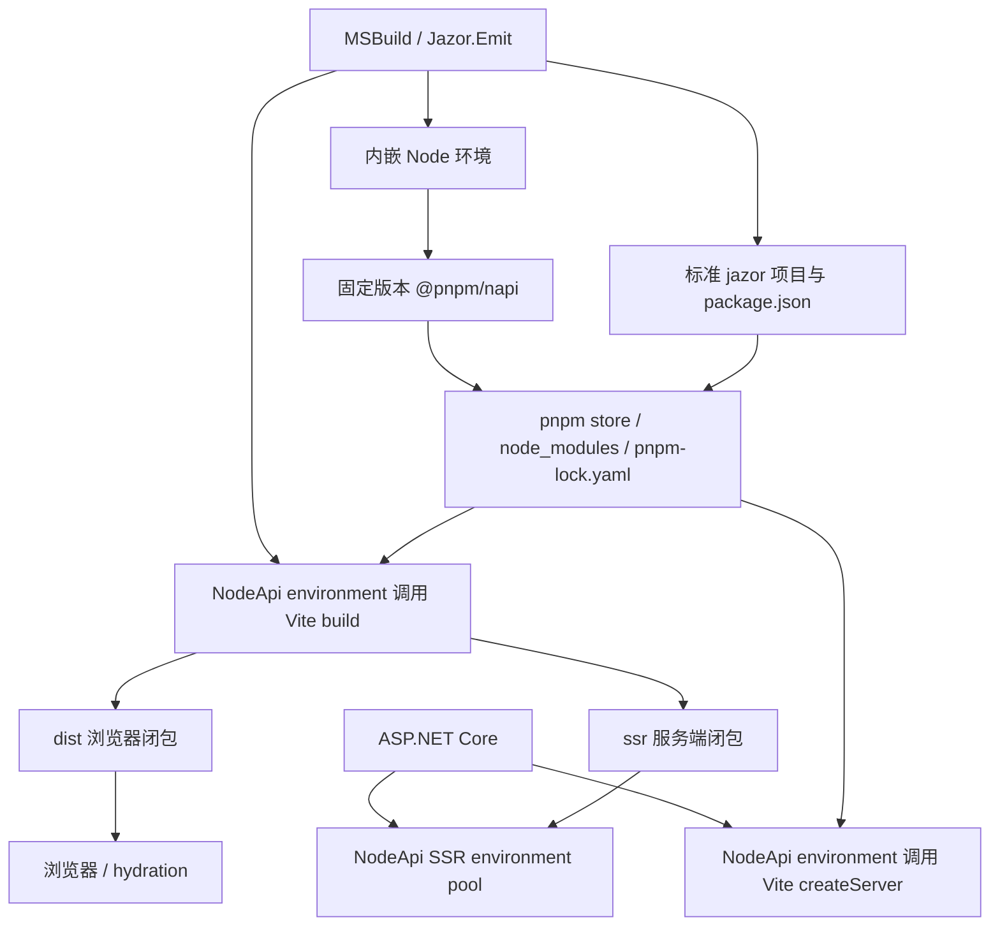

# Node.js 与 pnpm 迁移方案

> 状态：源码迁移与候选验收完成，维护者指定以 1.1.0 发布。编写日期：2026-11-11。迁移前基线：`e2abbf90` / `v1.0.0`。当前分支已接入 NodeApi 工具链，支持声明仍以实际平台和门禁证据为准；不会覆盖已发布的 1.0.0。

Jazor 将前端工具链与服务端 JavaScript 执行迁往完整的 NodeApi 技术栈：C# 内嵌 Node，通过 `@pnpm/napi` 恢复依赖，并在内嵌环境调用工具与渲染 API。不得以独立 Node、pnpm、tsc 或 shell 进程完成验证或替代该目标。首先用 WebIDL collector 验证安装、TypeScript 转译、ESM 加载与结果回传；Vite 和 SSR 在同一进程约束下另行完成生命周期设计及验收。迁移完成后，正式交付闭包不再依赖 DenoHost 或 Deno。

WebIDL 试点的实现、固定版本与当前限制见 [collector README](../../src/ECMAScript.WebIDL.Generator/README.md)，可通过 `dotnet run --file scripts/csharp/verify-webidl-nodeapi.cs` 复现；其结果不代表其余产品路径已通过验证。

已接受的宿主配置：`CETCompat=false`。仓库可执行项目、测试宿主和 Jazor NuGet 的构建接线统一设置，不将其作为待决阻断项，也不引入替代执行路线。

当前实施固定 NodeApi `0.9.36`、LibNode `20.1800.215` 与 `@pnpm/napi` `12.5.1`，以 `Directory.Build.props` 为准。后文外部资料中的候选版本用于决策背景，不能替代已验证的组合。

Windows x64 已通过共享宿主、WebIDL、Vite/HMR、Vue SSR、Pinia/VueRoute DOM、JazorAdmin、Wiki PathBase、Authoring 和本地 NuGet 的独立 SPA/SSR 发布目录验证。Release 主测试、默认 Debug 覆盖率门禁已通过。四平台 CI（Windows x64、Linux x64、macOS x64/ARM64）已验证 pnpm、原生 addon、Vite 与 CSS、源码/部署 SSR、取消和固定 WebIDL 基线；见 [NodeApi CI](https://github.com/devhxj/Jazor/actions/runs/43019983602)。最终[四平台组合 CI](https://github.com/devhxj/Jazor/actions/runs/43030143205)还通过 37 项 ASP.NET hosting/标准项目回归和 NuGet 资产闭包；Windows 的完整 Emit 消费者 48/48、干净 23 包 SPA/SSR 浏览器门禁均通过。Linux/macOS 的组合结果不等同于 Windows 浏览器发布门禁，也不外推到未验证 RID 或 musl。

公开 API 对比确认删除 Vite/SSR 的 `TaskName` 及其访问器，旧稳定基线比较按预期失败。结合 CLI、lock 和 scripts 的迁移，维护者指定本次底层重构以 1.1.0 发布；配置迁移继续明确记录，API 门禁仅放行已审阅签名，不覆盖既有 tag 或改写旧基线。可重复入口为 `test-dotnet.cs`、`verify-webidl-nodeapi.cs`、`verify-nodeapi-pipeline.cs`、`verify-windows-spa-release.cs` 与 `verify-windows-ssr-release.cs`。

pnpm 原生安装没有取消接口，当前契约是等待实际安装结束再传播取消，期间不启动后续阶段。SSR/Vite/测试环境在可调度 JS 线程上终止并等待退出；同步无限循环的中断仍不支持。布局采用实际验证的 hoisted linker；不宣称已采用 isolated linker，也不执行依赖 lifecycle shell scripts。

Vite 的 CSS 阶段固定使用同版本官方 `lightningcss-wasm`，其选择进入 pnpm override 与 lock 身份。旧 napi-rs Windows addon 只从主 executable 查找符号，无法满足内嵌 .NET 宿主；WASM 仍在当前 NodeApi environment 执行，真实 TDesign Release 图保留 CSS 压缩。它是固定工具实现，不是失败后的 fallback。

## 一、背景与决策依据

### 1.1 上游变化

Ryan Dahl 于 2026-10-09 在 [Deno is joining Cloudflare](https://deno.com/blog/cloudflare) 宣布整个 Deno 团队加入 Cloudflare。公告对不同产品分别作出安排：

| 项目 | 公告内容 | 对 Jazor 的影响 |
| --- | --- | --- |
| Deno runtime | 继续一年、按月发布缺陷修复和安全更新，之后团队停止开发；源码继续开放 | 当前本地工具链仍可运行，但需要在维护窗口结束前完成迁移 |
| Deno Deploy | 六个月后关闭，并提供付费客户迁移支持 | Jazor 当前本地宿主不依赖 Deploy，不会随其关闭直接失效 |
| JSR | 继续运营，基础设施迁往 Cloudflare | 保留 JSR binding identity；单独验证 pnpm 中的安装和标准 ESM 导入 |
| rusty_v8 | 继续维护，并向 workerd 集成 | 不构成本次采用另一套内嵌 V8 宿主的理由 |

一年和六个月均为公告中的相对窗口，约对应 2027 年 10 月和 2027 年 4 月；不据此推定上游承诺了某个具体停服时刻。迁移应先完成真实消费者闭环，再切换正式版本。

### 1.2 已核实的程序化接口

以下为编写日核实的信息，实施时仍须重新固定完整版本组合：

| 依赖 | 已核实事实 | 使用约束 |
| --- | --- | --- |
| node-api-dotnet | 支持同一进程内 .NET/JS 双向互操作、Task/Promise、对象封送；官方仍把内嵌 Node 场景标为 experimental | .NET 包与配套 `libnode` 必须作为一个组合验证，不能只升级其中一个 |
| `@pnpm/napi` | `12.19.0` 已发布在 `next-12` 标签下，提供 pnpm Rust 引擎的 Node-API 绑定 | 固定明确版本；当日默认 `latest` 仍为占位版本 `0.0.0-0`，不能使用无版本安装 |
| `@pnpm/napi` 的安装接口 | 提供 `install`、`rebuild`、依赖解析、配置读取、锁文件读写和日志回调；README 以 Bit 为程序化消费者示例 | API 契约不等于 CLI 的全部行为，按所选发布版 `index.d.ts` 实现适配 |
| `@pnpm/core` / 旧 supi 路线 | 另一条 JS 安装引擎集成路线 | 本方案优先使用 `@pnpm/napi`，不同时维护两套安装引擎 |

已发布接口的核心形态为：

```ts
install(
  options: InstallOptions,
  onLog?: LogListener,
  readPackageHook?: ReadPackageHook,
  onOutput?: OutputListener,
): Promise<InstallResult>
```

所选版本提供的 `InstallOptions` 包括 `dir`、`projects`、`storeDir`、`nodeLinker`、`frozenLockfile` 等；`projects` 携带项目目录与内存中的 manifest。安装不应被简化为“传一个路径，自动执行所有 CLI 配置行为”。当前签名也没有取消参数，C# 取消等待不等于引擎停止。

### 1.3 本方案的决策

| 决策 | 结论 | 原因 |
| --- | --- | --- |
| 包管理器 | 采用 pnpm，固定版本和 `pnpm-lock.yaml` | 共享 store 适合多个测试工作区和消费者项目；隔离布局使依赖声明缺口更容易被发现 |
| 依赖恢复入口 | 优先实施内嵌 Node + `@pnpm/napi`，通过 P0 后纳入产品 | 直接取得结构化结果、日志和错误，避免解析终端展示文本 |
| Vite | 内嵌环境调用标准 Vite API，WebIDL 试点之后验证 | 明确 server、watcher、HMR 和 close 的进程内生命周期 |
| SSR | 内嵌环境直接调用 Vue SSR，WebIDL 试点之后验证 | 明确 environment 池、generation、取消和故障传播 |
| 执行约束 | 全程 NodeApi，不启动 JS 工具子进程 | 不将 Node CLI 成功当作内嵌技术栈的验收结果 |
| 宿主选择 | 正式版只具有一条已经验收的恢复主线 | 不实现失败后自动从 API 切 CLI、切 npm 或回到 Deno 的 fallback |

若 P0 证明内嵌恢复无法满足必须的取消、退出或平台要求，应记录阻断项并修复或重新评审产品契约，不能用 CLI 或独立 JS 进程绕过本方案的验证目标。

### 1.4 edge-js 候选评估

2026-11-11 核对 [edge-js README](https://github.com/agracio/edge-js) 与 [C# 项目条件编译](https://github.com/agracio/edge-js/blob/master/src/double/Edge.js/Edge.js.csproj)：它持续跟进 Node 20/22/24/26/27，值得关注；但支持表中的 CoreCLR 支持属于 Node 托管 .NET，CoreCLR 托管 Node 方向仍标为不支持。项目虽然包含 `net8.0`，该目标编译的是 `dotnetcore` 桥接端；`EdgeJs.Edge.Func` 所在的 `dotnet` 源码只编入 `net462`。

Jazor 的入口是 .NET 11 / ASP.NET Core 主进程，必须由它创建 Node 环境。现有证据不足以将 edge-js 作为这条路径的替代。继续实施 NodeApi，按真实 pnpm/Vite/SSR、取消、退出及发布闭包验证决定是否可交付；Microsoft 名称本身不构成支持保证，当前 libnode 的版本滞后仍是需要解决的维护问题。

## 二、目标、范围与稳定边界

### 2.1 完成目标

1. 使用随包固定的 Node 工具链完成依赖恢复、开发启动、Release 构建和启用后的 SSR；消费者不需要全局 Node、pnpm 或 Corepack。
2. 使用 pnpm 的安装引擎、store 和锁文件，不在 C# 重写包解析、peer 处理、链接布局或锁文件格式。
3. 保持 Visual Studio F5、Ctrl+F5、Folder Publish 和命令行构建的一致行为。
4. 保持 Debug、Release、浏览器和 SSR 使用同一套声明依赖、模块 identity 与来源信息。
5. 同步迁移运行时测试、WebIDL collector、smoke、benchmark 和 CI，完整移除仓库所有受维护执行路径对 Deno 的依赖。
6. 新工具链的正确性、平台覆盖、取消与资源释放具有可重复证据；不把“理论上支持 Node-API”作为组合验收结果。

### 2.2 保持的产品边界

- 生产编译路径仍是官方 Razor SG C# → Roslyn `IOperation` → `Jazor.Compiler` / `SemanticWalker` → Vue render-function `.mjs`。
- `AstConverter`、writer/`ESGenerator`、`Jazor.Emit` 的 AST、文本/source map 和文件物化职责保持分层。
- 浏览器继续执行标准 ESM；不会因为引入 Node 互操作而获得浏览器 CLR、任意 JS 字符串执行 API 或服务器对象直通能力。
- 两种类库 carrier、binding identity、显式资源闭包、强类型 C# API 和 usage-site lowering 规则继续生效。
- `AddJazorFrontend`、`UseJazorPathBase`、`UseJazorFrontend`、`AddJazorSsr`、`UseJazorSsr` 的作者路径继续沿用；运行时和项目脚本变更单独评估兼容性。
- SSR 的 state envelope、providers、认证快照、每次渲染创建 Vue app、hydration 及失败不重放的契约继续沿用。

### 2.3 范围之外

本次不增加浏览器 Node API、通用 C# `Eval`、任意包管理器插件、分布式 SSR、远程任务服务、新认证体系、额外安全审计协议或自定义包缓存系统。既有数据格式、路径、依赖一致性和错误传播检查按迁移需要保留。原生资源的来源、版本、内容校验和许可证属于正确交付的必要条件，不据此建设新的签名基础设施。

## 三、仓库现状与改动地图

源码基线使用 `DenoHostVersion=2.9.7`。下表是实施入口，不是只改这些文件即可完成迁移的封闭清单；每一阶段都应检查对应引用闭包。

| 范围 | 当前入口 | 迁移责任 |
| --- | --- | --- |
| 工具链版本 | [Directory.Build.props](../../Directory.Build.props) | 固定 Node、NodeApi、libnode、pnpm 引擎版本；最终移除 DenoHostVersion 和仅为它设置的属性 |
| 恢复与检查 | [NodePackageRestorer.cs](../../src/Jazor.Emit/NodePackageRestorer.cs)、[EmitPipeline.cs](../../src/Jazor.Emit/EmitPipeline.cs) | 替换恢复引擎、锁文件、增量身份、检查和取消行为 |
| 项目配置 | [LibraryPackageWriter.cs](../../src/Jazor.Emit/LibraryPackageWriter.cs)、[LibraryPackageIdentity.cs](../../src/Jazor.Emit/LibraryPackageIdentity.cs) | 写入 pnpm 配置与 scripts；处理 npm alias、JSR 和已有作者配置 |
| 构建 | [JavaScriptProjectBuilder.cs](../../src/Jazor.Emit/JavaScriptProjectBuilder.cs)、[ViteProjectWriter.cs](../../src/Jazor.Emit/ViteProjectWriter.cs) | 内嵌 Node 调用 Vite API；保持 bundle、CSS、manifest、source map 和 tree shaking |
| 入口与 SSR runner | [ProjectEntryWriter.cs](../../src/Jazor.Emit/ProjectEntryWriter.cs)、[ssr-runner.js](../../src/Jazor.Emit/tooling/ssr-runner.js) | 用 Node HTTP 接口替代 `Deno.serve`；保留渲染及请求/响应协议 |
| 开发宿主 | [JazorViteDevelopmentServer.cs](../../src/Jazor.AspNetCore.Dev/JazorViteDevelopmentServer.cs) | 替换 DenoProcess、参数转发、ready、日志及进程树释放 |
| SSR 宿主 | [SsrRenderer.cs](../../src/Jazor.AspNetCore/SsrRenderer.cs)、[SsrArtifactLocator.cs](../../src/Jazor.AspNetCore/SsrArtifactLocator.cs)、[JazorSsrOptions.cs](../../src/Jazor.AspNetCore/JazorSsrOptions.cs) | Node worker、开发 pnpm lock、发布闭包、generation 和取消 |
| MSBuild 与 NuGet | [Jazor.props](../../src/Jazor/build/Jazor.props)、[Jazor.targets](../../src/Jazor/build/Jazor.targets)、[Jazor.csproj](../../src/Jazor/Jazor.csproj)、[Jazor.Emit.csproj](../../src/Jazor.Emit/Jazor.Emit.csproj) | 构建机/目标 RID、原生资产、工具资源、复制与发布规则 |
| 编译器与 CLR 测试 | `src/Jazor.CompilerTest`、`src/Jazor.CLR.Test` | `Deno.Execute`、`Deno.test` 和 runtime package 引用迁移，保留行为断言 |
| RazorVue 测试 | [RazorSgOfficialNodeRuntimeTestHost.cs](../../src/Jazor.RazorVue.Sg.Test/RazorSgOfficialNodeRuntimeTestHost.cs) 及调用方 | 共享进程内 runner、临时项目、测试专用 ESM loader 与 runtime fixtures |
| Emit 与绑定测试 | `src/Jazor.EmitTest`、Style、Vue Devtools、Pinia、VueRoute 等测试项目 | 恢复、发布、进程、DOM shim 和依赖布局验证 |
| WebIDL 工具 | [NodeWebIdlCollector.cs](../../src/ECMAScript.WebIDL.Generator/NodeWebIdlCollector.cs)、[collect.ts](../../src/ECMAScript.WebIDL.Generator/node/collect.ts)、`GeneratorOptions` / `RepositoryLayout` | 纯进程内试点，包含 pnpm API、TypeScript API、collector 和错误回传 |
| 脚本与样例 | `scripts/csharp/`、`samples/*/verify-smoke.cs`、Pinia/VueRoute consumer 配置、Wiki | 去除 Deno 查找/缓存/启动逻辑，使用当前输出的 Node 工具链 |
| CI | `.github/workflows/quality-gates.yml`、`razorvue-ci.yml`、Wiki/Pinia、RC 和发布 workflow | Node/pnpm 资产、缓存键、平台矩阵和发布前门禁 |
| 文档与规范 | 架构、安装、开发测试、发布、各项目 README、`AGENTS.md` | 切换完成后同步当前契约；计划阶段只新增方案与导航 |

不能只删除生产项目的 DenoHost 引用后宣布迁移完成。现有大量测试源码内包含 `Deno.test`、`npm:` specifier、Deno import map 或 Deno 执行命令；WebIDL collector 也是真实维护入口。

## 四、目标架构与所有权



### 4.1 共享宿主实现

产品主线阶段可提取 `src/Jazor.NodeHost` 内部实现项目，集中提供随包资产定位与内嵌 environment 管理。WebIDL 试点先在工具自身实现，取得证据后再提取共享代码。新名字是建议，不是已存在或已发布 API。

该项目默认随既有 `Jazor` 包交付，不先增加独立公开 NuGet 包或通用宿主框架。内部接口只覆盖实际调用：恢复、运行项目任务、运行模块/测试、启动长期服务。不得建立为了将来支持多引擎而设计的 provider 注册体系。

| 责任层 | 拥有的内容 |
| --- | --- |
| NodeHost 内部实现 | 固定工具链定位、NodeApi platform/environment 生命周期、线程/引用/异步/取消与原生资源选择 |
| Emit | binding 依赖闭包、标准项目信息、恢复时机与增量状态、默认 scripts、构建与产物物化 |
| pnpm 引擎 | 版本解析、peer、alias、store、`node_modules`、锁文件格式与安装结果 |
| Vite | 模块图、exports 条件、浏览器/SSR bundle、CSS、分块和 HMR |
| ASP.NET Core 集成 | ready 与 proxy、请求/worker 所有权、并发、generation、SSR HTML 和 hydration 交接 |

### 4.2 内嵌环境生命周期

1. 每个实际进程创建一个 `NodeEmbeddingPlatform`；由单一所有者管理，不随请求或测试重复初始化 platform。
2. 每次恢复通过明确归属的 environment 在指定项目根解析工具模块。所有 JS 操作调度到该 environment 的 JS 线程。
3. C# 的 options、结果和回调按固定类型封送；JS 临时值不跨线程保存，确有跨调用引用时使用宿主提供的 reference 生命周期。
4. 不在每个请求上初始化 platform，不以进程全局工作目录、环境变量或 `.npmrc` 的临时修改选择项目。
5. P0 验证 environment 销毁、再创建、并发项目、原生 addon 后台任务、回调异常、unhandled rejection 和进程退出。不能假定 `Dispose` 一定能够停止正在运行的 Rust 安装任务。
6. Emit 当前是独立工具进程；其退出必须确认安装已完成或按已验证的取消策略终止。不得留下仍在写入 `node_modules` 的任务，同时向 MSBuild 报告已取消。

验证脚本自身是承载 NodeApi 的 .NET 进程，脚本不另起被测 JS 进程。不可取消的安装不能只给 C# Task 设置超时后宣称已停止；未能终止原生工作就是待解决的契约限制。

### 4.3 C# 与 JS 适配边界

使用私有工具模块包装固定版本 `@pnpm/napi` 的窄接口，并以强类型 C# DTO 表达项目、安装选项、统计结果和诊断。仅映射当前 Emit 需要的字段，不把 pnpm 全部接口翻译成新的公共 C# API。

`PackageManifest` 在上游是开放 JSON 域。适配层可在内部保留从标准 `package.json` 读到的 JSON 数据和上游错误细节，但不得把它扩散为浏览器/host 作者面的 `object?` catch-all。JSON 转换是否用于适配层由 P0 按封送正确性决定，不以“全过程零拷贝”作为宣传或验收条件。

回调必须保留项目关联、错误码和堆栈。日志只经宿主统一出口进入 MSBuild/ILogger，避免原生 stdout、JS console 与宿主 logger 三次重复输出。渲染任务与安装任务使用各自拥有的环境或进程，不共享可变 JS 全局状态。

## 五、工具链引导、版本和跨平台交付

### 5.1 需要交付的三类资产

| 资产 | 用途 | 交付要求 |
| --- | --- | --- |
| JS 工具及模块资源 | Vite、SSR、JS 测试、collector 的 API 入口 | 在 NodeApi 环境中执行，不以 Node 可执行文件承接任务 |
| NodeApi 托管程序集与匹配 `libnode` | .NET 进程内执行 pnpm 引擎 | 采用上游要求的匹配版本，并验证每个支持 RID 的加载、API 和退出 |
| `@pnpm/napi` loader、类型/许可信息与平台 `.node` 依赖 | 安装引擎 bootstrap | 在打包工具链时恢复并固化；消费者首次构建不依赖外部 pnpm 安装它自己 |

`libnode` 不等于 Node CLI，也不自动附带 npm 或 pnpm。试点由 C# 引导固定的安装引擎资源，再交给 pnpm API 恢复应用依赖。需要派生 Node/shell 的生命周期脚本尚未满足本方案的执行约束；WebIDL 依赖均为纯 JS 并显式禁用这些脚本，不能据此声明任意 npm 包已支持。

P0 必须检查上游 LibNode 包实际可用的平台与 Node 版本。不能根据 NodeApi 的通用介绍推定它已经覆盖仓库所有平台。若找不到受维护 LTS、所需 RID 和 NodeApi API 均匹配的组合，内嵌主线不能通过 P0。

### 5.2 版本唯一来源

第三方工具链版本集中在一处仓库配置声明，由打包脚本投影到必要的 package manifest 和工具链元数据；不得在 C#、JS、MSBuild、测试和 CI 各写一套版本。该配置记录 Node CLI、NodeApi、libnode、pnpm engine 和 bootstrap 内容身份，属于工具链资产信息，不是新的应用模块 carrier。

P0 必须记录实际内嵌 Node 版本，不能用本机 Node CLI 版本代替。WebIDL 已验证组合及 Windows CET、布局和 pnpm 版本限制由工具 README 维护。

本方案不预先填写未经验证的 NodeApi/LibNode NuGet 版本。`@pnpm/napi@12.19.0` 是候选起点，不能单凭其存在跳过组合验证。工具链升级必须更改集中配置、恢复 bootstrap 并重跑平台门禁。

### 5.3 NuGet、构建 RID 与发布 RID

- 构建过程选择实际执行 Emit 的宿主 RID；交叉发布时，生产 SSR 选择 `RuntimeIdentifier` 对应的目标 RID。两者不能混为一次资产选择。
- Emit 的 `tools/net11.0/` 闭包携带 libnode、NodeApi、JS 工具资源和 pnpm bootstrap；源码构建输出遵循同样的相对定位规则。
- Web 宿主初始化 Vite/SSR environment 时，从自身输出里的明确资源位置加载库与模块。不能在部署时回指开发机的 NuGet cache、仓库 `bin/Debug` 或全局 PATH。
- 静态浏览器发布只交付既定 `dist/` 闭包；启用 SSR 的发布增加 `ssr/` 与目标 NodeApi/libnode 运行资源。生产启动不执行依赖安装，不要求 pnpm store。
- 只用于 Emit 安装的 pnpm bootstrap 不应因为包引用自动进入每个发布目录；纯静态宿主也不需要 SSR 内嵌资源。包形状与 publish 测试必须证明实际复制结果。
- 首批平台以当前已交付的 `win-x64`、`linux-x64`、`osx-x64`、`osx-arm64` 为最低目标，逐个执行真实验证。`win-arm64`、`linux-arm64`、musl 等仅在完整组合具有证据后新增，不由上游包列表自动扩大支持声明。
- 校验文件完整性、Unix executable bit、原生依赖、Windows 文件锁、许可和再分发条件。库文件布局与版本信息应足够诊断加载失败，不新增自研签名协议。

不通过修改全局 `PATH` 或补一个 Node 可执行文件绕开内嵌验证。涉及生命周期脚本或原生构建的包必须单独确认可在约束下完成，否则保持明确未支持状态。

## 六、依赖恢复与标准项目契约

### 6.1 项目布局

迁移后的标准前端根继续由最终宿主拥有，拟定布局为：

```text
jazor/
  package.json
  pnpm-lock.yaml
  pnpm-workspace.yaml       # 仅在所选版本的项目配置需要时生成，不创建虚假多项目 workspace
  node_modules/
  entry.js
  hydration.js             # 启用 SSR 时
  ssr-entry.js              # 开发 SSR 入口
  vite.config.js
  ssr.vite.config.js        # 启用 SSR 时
  ...现有模块与资源...
  dist/                    # 浏览器发布闭包
  ssr/                     # Release SSR 发布闭包
    package.json
    ssr-entry.js
    chunks/
```

`pnpm-lock.yaml` 是新恢复主线的唯一权威锁文件。`package.json` 继续保留作者 scripts、配置和已声明的额外依赖，Emit 只更新自己拥有的 binding dependency 与默认配置。pnpm 的版本、linker、peer/build 设置应使用所选版本支持的标准项目字段表达；API 调用与 CLI 复现必须读取同一份设置，不维护一套只在 C# 中存在的隐藏配置。

### 6.2 bootstrap 与应用依赖分离

安装引擎从工具链的独立 bootstrap 根加载，应用包安装到当前 `jazor/`。应用依赖变化不能覆盖 pnpm 引擎的 `.node` 文件或把工具依赖写入应用 `dependencies`。首次无 `node_modules`、断网且 bootstrap 已交付的场景也必须能加载引擎；应用包是否可离线安装取决于所需内容是否已在指定 store 中。

### 6.3 恢复事务

1. 从当前 binding 闭包生成并合并 `package.json`，读取标准 pnpm 项目设置。
2. 使用 pnpm 的配置接口取得所需配置，再构造当前项目的内存 manifest 和安装选项。上游 API 未代办的配置只按本次所需集合投影。
3. 第一次无 pnpm lock 的恢复执行允许生成锁文件的安装，成功后保留引擎生成的原始锁文件。
4. 同一根依赖身份且已有 lock 时使用 frozen 安装。frozen 失败应原样报告 pnpm 错误，不能删除 lock 后自动重新解析。
5. 作者明确修改依赖，或 Emit 的受管 binding 依赖确有变化时，执行明确的依赖更新事务；更新失败不得写成功标记，也不得声称旧依赖符合新配置。
6. 根依赖声明不能证明整个 lock 匹配，因此实际一致性仍由 pnpm 判断；C# 不实现第二套完整 lock 解析/规范化。
7. 只有安装、必要脚本和检查全部成功后才更新恢复状态。取消或失败产生的部分目录在下次恢复中交给引擎收敛，不承诺回滚文件系统。

### 6.4 增量恢复与 store

保留“作者模块变化不重新安装依赖”的行为，尤其避免 Windows 上重写 Vite 已加载的原生 `.node` 文件。恢复身份至少考虑会影响实际安装的根 manifest、pnpm lock、项目安装设置、安装引擎版本、运行平台/架构与选定 Node 语义；以实际影响项为准，不哈希整个 store 或每次扫描所有依赖内容。

恢复成功标记放在它对应的 `node_modules` 生命周期内；目录被删除、身份不符或上次操作失败时不能命中。`file:` 依赖与安装脚本产物按真实内容变化需求处理，不能仅凭版本字符串跳过。

开发和 CI 使用 pnpm 标准 store，通过每次调用的显式 `storeDir` 选择。并行测试各自拥有项目目录、lock、输出和状态；共享 store 的并发由引擎管理。冷安装测试使用自己拥有的空 store，不清空用户缓存；CI 缓存命中不得绕过 frozen 校验。

### 6.5 隔离布局、alias、peer 与 JSR

| 项目 | 迁移规则 | 必要证据 |
| --- | --- | --- |
| `nodeLinker` | 首选显式 `isolated`，先修复 binding 依赖声明缺口；存在具体工具不兼容时才评估标准 `hoisted` 设置 | Vue、Vue demi、Popper、FilePond、Floating UI、Lucide 等闭包完整；不借全局提升掩盖缺失依赖 |
| npm alias | 沿用标准 `npm:目标包@版本` 身份，由 pnpm 物化作者使用的名称 | imports、子路径、CSS 和动态导入正确；移除现有 Deno alias 目录复制逻辑 |
| peer dependencies | 使用固定配置和引擎 peer 语义，保持 binding 自带必要 runtime closure | Vue 单例、SSR/browser 一致，不能靠消费者手动补 manifest |
| JSR | 保留 authored JSR identity 与源码追踪；验证所选引擎的原生 JSR 安装能力及 Node import 形态 | 原生 `jsr:` 与既有 `@jsr/scope__name` 投影的关系明确；若需标准兼容分发，校验版本、exports、许可证和锁内容 |
| exports 与 CSS | 标准包 `exports`、条件导出和 `sideEffects` 继续归生态工具处理 | browser/SSR 条件正确、细粒度 tree shaking 和 CSS 闭包没有扩大或丢失 |

不得凭旧版本印象断言“pnpm 不支持 JSR”，也不能把对 `jsr:` 的包解析支持等同于 Node 可以直接执行任意 `jsr:` import。安装 identity、产物 specifier 与运行时解析应逐层验证。

## 七、检查、构建与项目 scripts

### 7.1 Deno check 的替代边界

`node --check` 只检查语法，不执行模块，也不等于 Deno 的依赖图检查或 TypeScript 检查。迁移应明确分开三个责任：

| 检查 | 目标方式 |
| --- | --- |
| 作者 C#/Razor 类型、成员、绑定 | 保持 Roslyn、Razor SG、Analyzer 和 Compiler 的既有使用点检查 |
| 已生成 JS 的语法 | 在内嵌环境中调用无执行的标准模块解析 API，或复用现有 C# ECMAScript parser；P0 验证模块模式与必要启动标志，覆盖 `.mjs` 与 `type: module` 的 `.js` |
| 依赖解析和完整构建图 | Release 由既有 Vite build/SSR build 验证；Debug 由 Vite 标准解析/加载与真实开发消费者验证 |

不通过提前执行每个应用模块验证静态语法，以免增加顶层副作用。Debug 是否需要在启动前获得与旧 `deno check` 同等范围的依赖图失败，必须在 P0 明确记录；若采用上述更晚的标准 Vite 诊断边界，应作为可观察行为差异进入版本和迁移说明。若产品要求提前检查，则复用 Vite 的标准图构建能力并测量成本，不编写另一套私有包解析器。

不机械增加 `tsc --noEmit`：C# 编译所得模块和任意作者 JS 不是同一类型检查契约。已有 TS 工具项目继续使用自己的标准编译配置。

### 7.2 scripts 与任务执行

默认 scripts 继续表达标准前端项目行为，例如 `dev: vite`、`build: vite build`、`build:ssr: vite build --config ssr.vite.config.js`。SSR 的新默认入口使用 Node；`ssr:dev` 是否使用 `node --watch` 由跨平台 watch 验证确定。

`@pnpm/napi` 是安装引擎，不具有通用 scripts 执行能力。内嵌主线应直接调用所选工具的标准 API，不能把 `package.json` 中任意 shell 命令解释为 JS API。现有 `TaskName` 和作者自定义 scripts 的适配、支持范围及迁移诊断，在进入 Vite/SSR 切片前明确，纳入 MAJOR 契约审查。

Vite 的 `build`、`createServer` 与服务实例 `close` 是后续候选接口；仍需实际验证其原生依赖、watcher、网络句柄和退出。WebIDL 的 TypeScript 转译已使用 `transpileModule`，没有 `tsc` 任务包装。

作者自定义 script 不被静默覆盖。已有 Deno-only script 应在升级指南中列出明确修改步骤；不把其失败解释为可以回退到全局 Deno 的信号。参数转发、包含空格的路径、项目 `.bin`、退出码、stdout/stderr 和取消均由标准任务入口与宿主管理。

## 八、Vite 开发宿主

保留现有 `AddJazorFrontend` / `UseJazorFrontend` 配置和 middleware 顺序，替换运行时接线：

1. 使用现有项目根与 configured origin 计算 readiness URL。
2. 已有 Vite 就绪时复用，不取得该外部进程的生命周期所有权。
3. 需要启动时，在拥有的 NodeApi environment 中调用 `createServer` / `listen`，传入项目、host、port、strictPort、base 配置。
4. ready 前不对外宣称服务已启动；启动失败保留项目、JS 错误和堆栈。
5. 继续代理 HTTP、查询字符串、PathBase 和 HMR WebSocket。
6. 停止时调用本宿主拥有的 Vite server 的 `close`，确认 watcher、socket 和后台句柄释放后再释放 environment。

Vite 及其原生依赖是否隐式派生进程，必须实际检查；若无法在约束下运行则记录阻断项，不将 CLI 包装作为完成。端口冲突仍应显式失败，不搜索备用端口。

同一次恢复后，作者 `.razor`/C# 修改触发的增量编译和 HMR 不能重装 `node_modules`。F5、Ctrl+F5、`dotnet run`、重启、连接外部 Vite 及 `LaunchServer=false` 都要保留独立回归。

## 九、SSR 迁移

### 9.1 Node runner 与协议

从 `ssr-runner.js` 提取可直接调用的异步渲染函数，移除 `Deno.serve` 执行依赖：

- C# 通过 NodeApi 直接调用渲染函数，无须为内部 SSR 建立本机 HTTP listener 或 stdout ready 协议。
- 输入继续为 `modulePath` 与版本化 state envelope；返回 HTML，异常通过 Promise rejection 回到 C#。
- `createSSRApp`、providers、`renderToString`、render-hook 错误收集和相对模块定位保持现有含义。
- 跨异步引用使用 `JSReference`，C# 请求数据只在所属 JS 线程封送，不把环境临时值带回请求线程。

内部执行协议变为进程内调用，SSR HTML 与 hydration state 的浏览器交付继续保持既定契约。是否使用 JSON 封送由类型和生命周期正确性决定，不以零拷贝作为前提。

### 9.2 常驻 worker、并发与取消

保留 `SsrRenderer` 的有界常驻 pool、空闲 worker 复用、generation 退休和 drain 顺序：

1. 每个 worker 是拥有独立 JS 线程的 NodeApi environment，每次请求创建新的 Vue app，模块缓存可复用。
2. `WorkerCount` 继续限制并发，默认值与正数约束维持现有行为。
3. 必须先验证协作取消和 environment 释放能力；取消 C# 等待不被当成已停止 JS。未能停止工作时不能宣称完成当前取消契约。
4. 模块加载或渲染失败显式向调用方传播，不能自动重放可能已有生命周期副作用的请求。原生崩溃可能影响整个 .NET 宿主，不能继续宣称进程隔离。
5. worker 失效后只允许后续独立请求创建新的 worker；不会为当前失败请求切换 CSR 或旧产物。
6. 释放宿主先停止接收并等待已接受任务按契约结束，再清理 pool；测试覆盖并发 dispose 和已释放 environment。

### 9.3 generation、watch 与 ESM cache

开发 generation 从入口、作者模块、`package.json`、`pnpm-lock.yaml` 及实际影响 SSR 的项目配置识别变化，沿用便宜 stamp 检查后再计算内容身份的现有策略。内容不变的时间戳更新不重启 worker。

Node ESM cache 通过轮换 environment 清除，不通过给 import URL 无限添加 query string 清缓存。文件变化由宿主现有 generation 机制或经过验证的进程内 watcher 触发，不能启动 `node --watch` 实现更新。

### 9.4 Release SSR 闭包

保持 Vite `noExternal` 策略及独立 `ssr/` 目录，但必须重新验证 Node 的条件导出。Node 内建模块允许作为运行时依赖；任意第三方裸包或原生 addon 若未被 bundler 收入，应明确物化其必要闭包，否则发布失败。

Release SSR 必须从部署目录独立运行：无开发源码、根 `node_modules`、pnpm store、`deno.lock` 或开发机路径。`SsrArtifactLocator` 的开发源图改为 pnpm lock，发布 bundled 图继续只要求其自足的运行闭包，不增加生产安装步骤。

## 十、测试、collector 与 CI

### 10.1 运行时测试迁移

将 `Deno.test` 改为在 NodeApi 中调用的测试函数，或已验证不派生进程的 `node:test` API，以 `node:assert/strict` 等保留断言；把 Deno 启动、权限参数、`npm:` import 和 import map 映射到内嵌标准模块或 fixture。WebIDL 试点采用导出测试函数，由同一 environment 调用。共享测试宿主先迁移，再迁移调用方。

| 范围 | 必须保留的证据 |
| --- | --- |
| Compiler / CLR | null/undefined、BigInt、数值溢出、异常、迭代顺序、单次求值、ref/out 等原有可观察行为 |
| Razor SG runtime | lifecycle、事件/绑定、slot、递归与闭包、DOM shim、SSR 相关状态 |
| Emit | manifest 合并、标准 package/alias/JSR、恢复状态、构建、NuGet 包与发布布局 |
| 绑定 | Style、Vue Devtools、Pinia、VueRoute 和已进入主线的生态包行为 |
| 真实浏览器 | Chrome 中实际交互、资源加载、HMR、PathBase 与 hydration，不能只靠 Node shim 声明浏览器支持 |

不为省事注入一个生产或测试全局 `Deno` 兼容对象。测试名称的 `OnNodeApi` 与 catalog 引用可在对应切片一致迁移；不得因改名丢失 test filter、场景目录或覆盖率范围。每阶段记录测试发现数和结果，任何减少都应有逐项解释。

测试拥有独立目录、端口、文件和 NodeApi environment；从当前测试输出选择内嵌资产，不回退到仓库默认 `bin/Debug`。多 lane 并发构建隔离输出，不增加常规 `DoNotParallelize`，不用进程全局环境变量传每个测试的配置。

### 10.2 WebIDL collector 与其他工具

把 collector 的 `Deno.args`、`Deno.env`、`Deno.mkdir` 和 `Deno.writeTextFile` 改为 Node 标准参数/环境读取与 `node:fs/promises`。TS 使用固定 Node 已验证支持的直接执行子集，或该工具明确的 TypeScript 构建步骤；不能假设所有 Deno TS 特性都能被 Node 原样执行。

同步调整 `GeneratorOptions`、`RepositoryLayout`、collector 项目 manifest、README 与 `collect.test.ts`。相同输入 inventory 和 MDN/spec 快照应保持确定性的绑定生成结果，工具迁移不顺带重采集或扩大公开绑定集合。差异必须区分工具变化与上游内容变化。

smoke、Wiki、Pinia/VueRoute consumer、benchmark 和 package 验证脚本全部沿用单文件 C# 入口。可复用验证新增在 `scripts/csharp/`，不新增 `.ps1` 或 shell wrapper；JS 模块只承担所需工具接线。

### 10.3 CI 与缓存

- 更新实际使用 Deno 的 workflow 和脚本入口，删除完成迁移路径中的 `DENO_DIR`、runtime 查找和 Deno cache 假设。
- pnpm store 的缓存键至少区分平台/架构、所选引擎版本、锁文件和影响安装的配置。缓存恢复不跳过安装身份与 frozen 校验。
- 增加无全局 Node/pnpm 的 packaged consumer lane，以随包资源证明引导；CI 安装的 Node 不能掩盖缺失资产。
- 保留源码、NuGet、Debug、Release、SPA、SSR 的独立消费者；Windows 和 Linux 运行端到端，macOS 两种既有 RID至少验证加载、恢复、Node 任务和 SSR 基本行为。
- 构建 RID 与目标 RID分别记录。没有目标平台真实运行的交叉打包结果只算包形状证据。
- 官方发布入口仍为 `.github/workflows/nuget-publish-ref.yml`，所有门禁通过后才上传；本地打包始终使用 `--skip-push`。

## 十一、实施阶段与依赖

角色表示模块所有权，由实施时的维护者认领，不预设个人或自动委派其他 agent。

| 阶段 | 主要 owner | 前置 | 交付物 | 退出条件 |
| --- | --- | --- | --- | --- |
| P0：可行性与版本组合 | NodeHost / Emit 维护者 | 本方案 | 单文件 C# probe、固定版本表、平台结果、取消与任务执行决策 | 所需 RID 的真实内嵌加载/安装、脚本与释放通过；发布通道和检查边界明确 |
| P1：宿主与工具链资产 | NodeHost / NuGet 维护者 | P0 通过 | 内部宿主实现、Node/libnode/bootstrap 交付、版本配置、包形状测试 | 干净消费者无全局工具可运行；构建/目标 RID 正确且失败诊断清楚 |
| P2：Emit 与 pnpm 恢复 | Emit 维护者 | P1 | manifest/lock/配置、API 适配、增量恢复、检查与构建 | 标准项目、alias/JSR/peer、frozen、失败/取消和 Windows 增量场景全部通过 |
| P3：Vite 开发闭环 | ASP.NET Core Dev 维护者 | P2 | 内嵌 Vite API、ready、proxy/HMR、server/environment 释放 | F5/Ctrl+F5、PathBase、外部 Vite、修改与退出均通过真实浏览器验证 |
| P4：SSR 与发布闭包 | ASP.NET Core / Emit 维护者 | P2、P3 的宿主基础 | Node runner、pool、generation、Release closure | 渲染/取消/重启/副作用、独立部署和 hydration consumer 全部通过 |
| P5：测试与工具迁移 | 各测试与 WebIDL owner | P1 起可逐项开展 | Node runtime harness、迁移后的测试与 collector、smoke/benchmark | 所有原有语义断言仍执行，受维护入口无需 Deno |
| P6：平台与候选验收 | CI / 发布维护者 | P2—P5 | 完整平台、性能、包形状、API/产物兼容性报告 | 当前质量门槛全部通过，无隐藏 Deno 运行依赖，升级演练成功 |
| P7：文档、切换与发布 | 文档 / 发布维护者 | P6 | 当前文档、CHANGELOG、用户迁移说明、官方发布 | 版本语义匹配变更，tag workflow 全部通过并保留证据 |

P0—P7 是依赖顺序，不是按日历承诺的工期。应以“能独立复现的完整切片”拆分 PR，避免在主线引入半套已启用的新工具链。新实现开发期间可以与旧代码暂存，但最终交付不提供自动 runtime fallback，也不为暂存状态增加公共 provider 配置。

### 11.1 P0 必须回答的问题

| 问题 | 验证方法 | 失败处理 |
| --- | --- | --- |
| 支持的 NodeApi/LibNode 组合是什么 | 固定 NuGet 与原生版本，逐平台初始化、加载 addon、调用 `engineVersion()` | 组合不成立则不进入 P1；修复组合或记录阻断，不换独立 JS 进程 |
| 引擎能否完成真实恢复 | 从空项目与空 store 恢复 Vue/Vite 及一个现有 Jazor binding 闭包，再 frozen 重装 | 记录失败包、日志与锁；不以 mock install 代替 |
| 配置与 manifest 如何进入 API | 对照发布版 `.d.ts`，验证 registry、标准配置读取、alias、peer、linker 与 store | 缺少必需能力时停止该 API 路线，而不是自行重写引擎 |
| 取消能否完成资源释放 | 对慢下载和 lifecycle 场景发出取消，检查写入、回调、子进程与宿主退出 | 仅取消等待不算通过；无法满足既有取消契约则修订执行边界 |
| 是否完整使用 NodeApi | 对照 C#/JS PID，检查是否存在工具 spawn/CLI 执行及隐式子进程 | 任一关键步骤转到独立 JS 进程都不算通过 |
| scripts 如何执行 | 固定 pnpm 任务 runner，验证自定义 script、`.bin`、空格参数、退出码 | 在 P1 前确定交付形状，不把 napi 当成 script runner |
| 多项目与线程是否隔离 | 同进程并行恢复两个独立项目，反复创建/释放 environment | 出现全局状态冲突时先收敛所有权，不使用全局变量绕开 |
| 升级是否破坏既有契约 | API baseline、MSBuild 属性、scripts、lock、Debug 检查时机和 publish layout 对照 | 依据实际破坏选择 MAJOR，不以 API diff 为零替代行为审查 |

WebIDL 的可复用验证入口为 `scripts/csharp/verify-webidl-nodeapi.cs`，报告归档到 `artifacts/webidl-nodeapi/`。后续产品级 P0 报告归档到 `artifacts/node-pnpm-migration/p0/`，包含命令、版本、RID、结果和原始失败。试点没有解决的取消、持续维护版本和平台问题仍是产品级门槛。

## 十二、验收矩阵与性能判定

### 12.1 必须通过的功能矩阵

| 维度 | 场景 | 验收标准 |
| --- | --- | --- |
| bootstrap | 无全局 Node/pnpm、空 `node_modules` | 随包资源可加载安装引擎并执行标准任务 |
| 首次恢复 | 空 store、无 lock、外部 binding | 安装成功，生成 pnpm lock，应用依赖与工具 bootstrap 分离 |
| frozen 恢复 | 有效 lock、冷/热 store、重复恢复 | lock 不被改写，内容与入口正确 |
| frozen 失败 | 显式 frozen 调用遇到 manifest/lock 不匹配、损坏 lock、不可获取的包或脚本失败 | 显式失败，不自动解析新版本，不写成功状态；与已明确授权的依赖更新事务分开验证 |
| 增量 | 作者源码改动、同内容重写、依赖/配置变更 | 前两者不重装依赖；后者按明确事务更新 |
| 依赖语义 | alias、peer、JSR、CSS、子路径、动态 import | Node/Vite/SSR 正确解析，binding 声明拥有完整闭包 |
| 取消 | 安装、build、dev 启动、SSR 请求 | 调用方状态正确；受拥有的写入与进程在已定义时间内停止 |
| 并发 | 多项目恢复、平行测试、多个 SSR 请求 | 无目录、环境、端口、原生资源或 JS 状态串扰 |
| 开发 | F5/Ctrl+F5、HMR、PathBase、外部 Vite | 浏览器收到正确资源和更新；只清理自有进程 |
| SSR | null props、providers、认证状态、异常、取消、模块更新 | HTML/state/hydration 一致；失败无重放、无静默 CSR |
| 发布 | SPA `/docs`、SSR `/todo`、复制到新目录后启动 | 无开发路径与 Deno；SSR 无生产安装；资源与 hydration 成功 |
| 平台 | 既有四 RID、构建/目标 RID 差异 | 包含包形状和目标平台实际运行证据 |
| collector | 固定 inventory 和文档输入 | 生成结果确定；变更不扩大绑定支持范围 |

### 12.2 性能与体积

先在 `v1.0.0` 建立当前 Deno 基线，再以相同机器、SDK、配置、项目输入、网络来源和缓存条件比较 Node/pnpm；性能数据随报告归档，不写成长期固定测试快照。

| 指标 | 测量方式 |
| --- | --- |
| 恢复 | 冷 store、热 store 重装、依赖不变跳过三组分别测量；至少五轮，报告中位数与范围 |
| clean/incremental/HMR/Release | 复用 `benchmark-razorvue-build.cs` 和真实 sample matrix，报告耗时、产物数量、变更文件和体积 |
| SSR | 复用 `benchmark-razorvue-ssr.cs`，分开冷启动与预热后采样；记录输入、轮数、并发、吞吐、p50/p95 和错误数 |
| 内存 | 新方案记录包含全部内嵌 environment 的 .NET 进程；旧方案比较 .NET 与其全部 Deno 子进程之和 |
| 存储 | 同时报告项目 `node_modules`、共享 store、NuGet 包和部署目录体积；区分共享、链接与实际占用 |
| 退出 | 安装取消、worker 更新和宿主停止的完成耗时，检查残留任务与文件锁 |

建议在 P0 采样后固定“稳定 warm build/HMR/SSR p95 回退不超过 10%”作为候选性能预算，并明确噪声判定方式；该数值是待采纳预算，不是已测结论。超出预算必须解释原因、提供优化或在切换前明确调整目标，不能以降低正确性门槛换性能。pnpm/API 的采用不以必然更快或更省内存为前提。

### 12.3 现有门禁入口

以下是当前已有命令，实施时更新它们内部的运行时接线，不另起一套较弱验收体系：

```text
dotnet build Jazor.slnx -c Release
dotnet run --file scripts/csharp/test-dotnet.cs
dotnet run --file scripts/csharp/verify-compiler-coverage.cs
dotnet run --file scripts/csharp/verify-razorvue-coverage.cs
dotnet run --file scripts/csharp/verify-vue-binding-coverage.cs
dotnet run --file scripts/csharp/verify-binding-documentation.cs -- --no-build --configuration Release
dotnet run --file scripts/csharp/verify-development-hmr.cs
dotnet run --file scripts/csharp/verify-windows-spa-release.cs -- --path-base /docs
dotnet run --file scripts/csharp/verify-windows-ssr-release.cs -- --path-base /todo
```

RC 统一入口继续为 `scripts/csharp/verify-release-candidate.cs`，它组织 API 兼容性、质量门禁、绑定、diagnostics、sample、包形状与 SPA/SSR consumer；参数及阶段以该脚本为准。发布前使用实际选定候选版本，不能把本方案里的候选技术版本当作 Jazor 包版本。

覆盖率和场景数量下限以[当前状态](./current-status.md#质量门槛与验证)为准：Compiler 至少 10,000 场景、98% 行/97% 分支；Razor-to-Vue 至少 4,000 场景、90% 行/94% 分支。不得因切换 runtime 删除语义测试、降低阈值或以 skip/inconclusive 满足门禁。

## 十三、升级、版本与切换

### 13.1 版本判定

Jazor 已发布 `1.0.0`。[发版规则](../03-guides/release-and-versioning.md)规定正式版后破坏性变更必须进入 MAJOR。

维护者于 2026-11-12 明确指定本次底层工具链重构以 `1.1.0` 发布，C# 编译语义与组件作者面保持不变。移除 Deno 配置/命令、Vite/SSR `TaskName`、替换锁文件、既有 shell scripts 和依赖布局的迁移仍按本页执行。这是本次发布的版本规则例外，不代表宿主配置完全兼容，也不改变以后破坏性变更进入 MAJOR 的规则。

API baseline 没有成员增删不能证明工具链契约完全兼容。CLI、MSBuild 属性、任务来源、启动/取消、部署资产和支持平台都属于版本审查内容。

### 13.2 用户升级流程

1. 将全部 `Jazor` / `ECMAScript.*` NuGet 引用升级到同一实际发布版本。
2. 检查项目是否设置 `JazorDenoPath`、`JAZOR_DENO_PATH`、Emit `--deno`，或依赖 `deno.json` tasks；按发布指南删除/替换，不能将 Deno 路径重新解释为 Node 路径。
3. 备份作者拥有的 `package.json` scripts、Vite 配置和额外依赖；停止旧 Vite/SSR 进程。
4. 用新工具链更新 Emit 拥有的配置，审阅自定义脚本。工具只能可靠更新已识别的旧默认脚本，不能猜测任意作者命令。
5. 首次 pnpm 恢复不复用 Deno 的 `node_modules`；清理项目拥有的旧安装目录，生成新的 pnpm lock。锁格式迁移不保证所有传递版本完全相同，必须审阅解析差异。
6. 成功后以 pnpm lock 为权威；旧 `deno.lock` 与其他包管理器 lock 的保留/删除由明确的迁移步骤执行，不能在普通构建中随意删除作者文件。
7. 运行 Debug/HMR、Release、PathBase 和启用后的 SSR/hydration，重新发布到干净目录。生产机器不需要重新安装依赖。

如果项目根由 Emit 可再生，指南可以让用户重建该根；如果包含作者配置，则必须先保留并合并。不得把整目录删除作为所有消费者唯一升级方式。

### 13.3 移除旧入口

本次切换统一删除 DenoHost runtime 引用、Deno 执行实现、旧 CLI/MSBuild 参数和只服务于它的设置，并更新指南与错误文本。参数移除应得到正常的未知参数/明确迁移诊断，不能被静默忽略。

`JsonSerializerIsReflectionEnabledByDefault` 当前含有 DenoHost 原因的设置。移除前检查其他序列化调用和发布模式，不因删掉注释就假定该属性已无其他使用需求。新的 NodeHost 不继承其无关 workaround。

### 13.4 回退与发布

切换前发现门禁失败则继续修复候选或停止该切片进入主线，不修改已经发布的 `v1.0.0` tag。消费者需要回退时，恢复已知正常的旧 NuGet 版本、相应源码/配置和构建产物；两种 lock 不在同一恢复事务中混用。

发布使用新的版本 tag 与官方 workflow，所有 lockstep 包同版本；本地 package 验证只使用 `--skip-push`。若新版本已公开后发现问题，通过新修复版本或明确回退说明处理，不覆盖已发布包或重指稳定 tag。

## 十四、风险、决策门槛与完成定义

| 风险 | 必须取得的证据或处置 |
| --- | --- |
| 内嵌宿主仍属实验接口 | 固定组合与各平台加载/退出结果；无法满足则在 P0 改变执行决策 |
| pnpm API 与 CLI 配置行为不同 | 对照发布版接口和标准项目配置逐项验证，确保手工 CLI 复现使用同一依赖/lock/linker |
| 原生 addon 与 Node/libnode 不兼容 | `.node` 加载、安装、回调、线程和 environment 销毁的真实测试 |
| 安装无法取消或脚本残留 | 慢任务取消、宿主退出与文件锁证据；不把取消等待当成取消操作 |
| 隔离布局暴露漏依赖 | 修复 binding 的必要声明，以真实消费者证明，不默认全量 hoist |
| JSR 与条件导出差异 | 固定包的安装、标准 import、CSS、browser/SSR 条件与版本一致性 |
| environment 与原生句柄释放 | ready、重建、失败传播、generation、watcher 和网络句柄的跨平台测试 |
| NuGet 或部署体积上升 | 分离 build 与 runtime 资产，报告真实包/目录大小，不预设体积下降 |
| 依赖图检查时机变化 | P0 固定契约，发布说明列出诊断时机与行为差异 |
| 平台支持缩减 | 任一既有平台缺证据均阻止无说明切换；兼容性变化进入版本决策 |

完成定义如下：

- [x] P0 版本、执行方式、取消、scripts 和检查边界都有实际证据，未决必需项为零。
- [x] Emit、Vite、SSR、测试、collector、smoke、benchmark 和 CI 的受维护执行路径均可在没有 Deno 的环境运行。
- [x] 依赖恢复、工具与渲染通过 NodeApi 使用明确固定资源，bootstrap 不依赖消费者全局工具，不启动 JS 工具子进程。
- [x] npm alias、JSR、peer、CSS、tree shaking、动态模块和跨平台依赖闭包通过真实验证。
- [x] 依赖不变的增量构建不重装；失败/取消不留下成功状态或仍在运行的自有任务。
- [x] SPA/SSR 发布从干净部署目录独立运行，PathBase、资源、hydration 和失败副作用契约成立。
- [x] 主线、覆盖率、API/产物兼容性、绑定、包形状、平台和性能报告完成，既有门槛没有降低。
- [x] 依赖清单和执行资产中无 DenoHost/Deno 残留；历史文档、旧版本说明和迁移说明中的文字引用允许保留。
- [x] 当前架构、安装/开发/发布指南、项目 README、`AGENTS.md` 与 CHANGELOG 同步，支持声明仅覆盖有证据的平台和能力。
- [x] 维护者指定版本为 1.1.0，并保留宿主配置迁移记录；源码候选的本地门禁已通过，正式发布必须由官方 workflow 在该 ref 上重新验收。

源码候选已完成上述执行路径、资产与本地质量门禁验收，正式发布仍须在 v1.1.0 ref 上由官方 workflow 重新执行门禁。本地实施报告写入 `artifacts/node-pnpm-migration/`，稳定结论在完成时收敛到架构、指南和当前状态；探索过程由 Git 和候选报告追溯，不长期堆积为新的历史快照。

## 十五、参考资料

外部资料与接口事实核实于 2026-11-11；API 实施以实际固定版本的发布产物为准。

- [Deno 官方公告](https://deno.com/blog/cloudflare)
- [node-api-dotnet 仓库](https://github.com/microsoft/node-api-dotnet)
- [.NET 内嵌 Node 指南](https://microsoft.github.io/node-api-dotnet/scenarios/dotnet-js)
- [JS 线程与异步约束](https://microsoft.github.io/node-api-dotnet/features/js-threading-async)
- [`@pnpm/napi@12.19.0` 发布版 README](https://unpkg.com/@pnpm/napi@12.19.0/README.md)
- [`@pnpm/napi@12.19.0` 发布版类型契约](https://unpkg.com/@pnpm/napi@12.19.0/index.d.ts)
- [`@pnpm/napi` registry 标签](https://registry.npmjs.org/@pnpm/napi)
- [pnpm install 与 frozen lock](https://pnpm.io/cli/install)
- [当前产物管线](../02-architecture/artifact-pipeline.md)
- [类库产物与引用契约](../02-architecture/library-artifact-contract.md)
- [开发与测试](../03-guides/development-and-testing.md)
- [当前状态与门禁](./current-status.md)
- [发版与版本规则](../03-guides/release-and-versioning.md)
