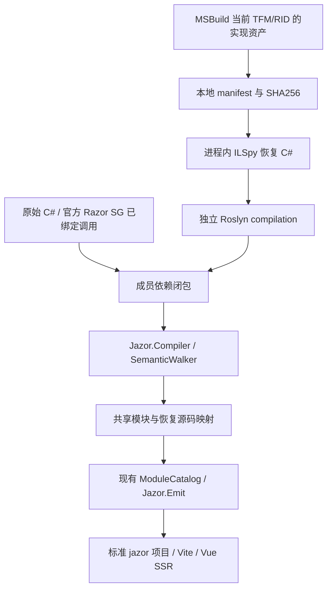

# 普通 C# / NuGet 类库导入

> 1.4.2 交付说明，对应 [issue #4](https://github.com/devhxj/Jazor/issues/4)。本页记录实现、用法和边界；早期探针仅保留在[历史演进](../05-history/evolution.md)。

## 使用方式

应用直接引用 `Jazor`，像普通 C# 项目一样引用 NuGet 或 `ProjectReference`。工具链根据实际使用点自动恢复所需实现，无需额外导入项，也无需逐类型标注。

```xml
<ItemGroup>
  <PackageReference Include="Jazor" Version="2.0.0" />
  <PackageReference Include="Fastenshtein" Version="1.1.1" />
</ItemGroup>
```

```csharp
using ECMAScript;

[ECMAScriptModule("app.mjs")]
public static class App
{
    public static int Distance(string left, string right) =>
        Fastenshtein.Levenshtein.Distance(left, right);
}
```

跨库依赖从同一份已解析本地实现资产中按需恢复；未使用的程序集不会反编译。BCL、宿主映射和生产者预编译 catalog 优先走既有实现，不由自动恢复替代。RazorVue 项目另行直接引用同版本 `Jazor.Vue`，在模板表达式、`@code` 和代码后置中按普通 C# API 使用。

生产者无需安装 Jazor、添加 `[ECMAScript]`、提供 PDB 或修改源码。已携带 `ModuleCatalog` 的 Jazor 类库继续按[类库产物契约](../02-architecture/library-artifact-contract.md)消费。自动恢复不等于声明整包兼容。

## 实现与交付



`Jazor.LibraryImports.targets` 从 `ResolveReferences` 的 `ReferenceCopyLocalPaths` 和 `RuntimeCopyLocalItems` 生成 `.jazorimports` AdditionalFile，排除 NuGet native 资产。1.4.3 起，同时按 `ReferenceSatellitePaths` 与 `Culture` 元数据排除本地化卫星程序集；这些资源继续进入正常构建输出，不参与 ILSpy 实现恢复。类库关闭 CopyLocal 时仍使用已解析的托管 runtime 资产；manifest 记录当前 TFM/RID 的实现输出和内容哈希，保留原有编译引用。缺少实现、只有 reference assembly、身份不匹配或准备后的文件改变时明确失败。

`OrdinaryLibraryImportPlan` 使用固定版本 `ICSharpCode.Decompiler 11.2.0.10050` 的库 API；不启动 `ilspycmd`，不联网查找实现，不递归恢复 BCL。恢复 C# 在独立 Roslyn compilation 中绑定，保留程序集版本和 public key。原始/恢复符号按程序集身份、metadata 类型名、成员种类、泛型参数位置、参数和返回引用种类结构匹配，不改变消费者及 Razor SG 的绑定。

当前会反编译被使用程序集的顶层类型，随后只对可达成员检查绑定并执行 lowering。它不是逐方法反编译器；大程序集仍可能有明显的恢复开销。闭包包含直接调用、方法组、构造、访问的 getter/setter、必要字段和初始化副作用。无关后端成员、未使用重载及未访问 accessor 不参与 lowering。

每个实现程序集输出一个 `_jazor/libraries/<AssemblyName>-<内容哈希前16位>.mjs`，所有入口通过确定性 import 共享类型和静态状态。模块进入现有 catalog，由 Emit 物化 `.mjs`、`.map`、manifest 与 bundle。RazorVue 在官方 SG 完成后加入实际组件根，使用可穿过 Vue reactive proxy 的私有存储表示；不新增 UI 模板或 slot marker 协议。

## 支持范围

| 范围 | 当前行为 |
| --- | --- |
| 普通 DLL / NuGet / ProjectReference | 按使用点恢复已解析实现；无 PDB、独立 ref/implementation 资产均有回归 |
| 静态算法与直接依赖 | 可达方法、私有 helper、受支持泛型方法及重载；跨普通程序集直接调用 |
| 普通 class | 构造、私有实例状态、字段、属性、索引器、既有 ref/out 协议；多构造使用 Roslyn 绑定 selector |
| 继承与虚调用 | 同导入程序集内既有类继承和已知可达 override；外部 base 与未实现分派明确失败 |
| 初始化 | 保留字段和 auto property 初始化副作用；静态存储先赋默认值再执行表达式；同类型回调可读后续字段默认值 |
| 共享与调试 | 多入口共享 class/static state；source map 指向 `jazor-recovered/...` 并携带恢复源码，不伪装原始行号 |
| RazorVue | 官方 Razor SG、真实 Vue reactive state 和打包消费者 SSR；C# 仍由 Compiler 翻译 |

仍不支持导入 struct/record 的运行时重建、显式 static constructor、跨导入类型的静态初始化依赖、外部基类构造、`this(...)` 构造链、未实现接口/虚分派和每个闭合泛型独立静态状态。跨类型初始化需要独立的 lazy type-initialization 协议，不能靠排序宣称等价。

恢复成功不表示 CLR 语义可用。可达的 `System.IO.File`、反射、动态装载、P/Invoke、线程等未实现运行时操作仍由 `SemanticWalker` 在使用点拒绝。缺少本地实现或超出支持范围的外部运行时操作仍明确失败。Analyzer 消费相同本地 manifest，准备失败使用 `JAZOR007`；lowering 失败通过现有 Compiler/RazorVue 诊断通道报告。

## 增量与缓存

导入计划和模块产物按不可变 compilation 保存并在进程内复用。实现内容哈希改变时，准备输入、恢复计划、模块路径及消费者 import 失效；引用图、语言/编译设置、Compiler 或恢复器版本变化进入新的 compilation/build。未变化 manifest 使用 `WriteOnlyWhenDifferent`，由 MSBuild 正常增量编译复用输出。

当前没有跨进程持久化反编译缓存，也没有仅按 package ID/版本复用恢复 AST 的旁路。未来持久缓存必须同时区分实现内容、引用图、TFM/RID、恢复器版本/设置、Compiler 版本及成员集合。

## 验收与后续

自动回归包括真实 Fastenshtein 1.1.1、普通 Release DLL、ref/implementation 配对、精确重载/嵌套泛型、跨库调用、共享状态、初始化顺序、未使用不支持成员裁剪、错误输入、恢复源码映射和内容变化失效。打包消费者覆盖 Debug/Release × 普通模块/RazorVue、关闭 CopyLocal 的类库、真实 Vue SSR 及 Chromium 中的挂载和点击更新，并检查无变化重建及实现变化后的运行结果。

```text
dotnet test src/Jazor.CompilerTest/Jazor.CompilerTest.csproj --filter FullyQualifiedName~OrdinaryLibraryImportTests
dotnet test src/Jazor.EmitTest/Jazor.EmitTest.csproj --filter FullyQualifiedName~Build_LocalJazorPackage_OrdinaryLibraryImports
```

发布需通过[质量与交付门禁](./current-status.md)。新增库先验证实际调用闭包与 JS/.NET 结果，按具体消费者需求扩展缺失协议。

依据：[ILSpy](https://github.com/icsharpcode/ILSpy)、[库 API](https://github.com/icsharpcode/ILSpy/wiki/Getting-Started-With-ICSharpCode.Decompiler)、[Microsoft reference assemblies](https://learn.microsoft.com/en-us/dotnet/standard/assembly/reference-assemblies)、[Fastenshtein 1.1.1](https://www.nuget.org/packages/Fastenshtein/1.1.1)、[Compiler 实现原则](../../src/Jazor.Compiler/ImplementationPrinciples.md)与[编译器架构](../02-architecture/compiler.md)。
