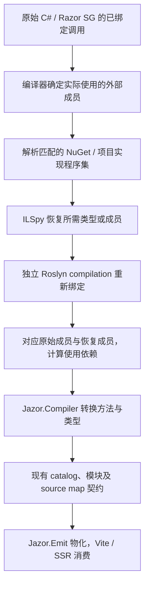

# 普通 C# / NuGet 类库转译方案研究

> 状态：研究方案，尚未实现生产级普通 DLL 导入。本文定义候选结构与验收；早期探针结果见[历史演进](../05-history/evolution.md)。

> 优先级：**P0**，对应 [issue #4](https://github.com/devhxj/Jazor/issues/4)。在普通类库导入、LibNode LTS 和 `.jazor` 三项提案中首先推进；首个静态成员切片可使用当前宿主验证。实施顺序与交付门槛见[下一阶段](./next-development.md#三项提案的实施优先级)。

## 建议

保留现有的生产者预编译路线，并为未接入 Jazor 的类库研究独立的 DLL 按需导入能力：从匹配的实现程序集恢复被使用的 C# 方法，通过 Roslyn 重新绑定，继续使用 `Jazor.Compiler` 生成 JavaScript。优先验证静态计算方法及其直接依赖，再推进实例类型和跨程序集调用。

这条路线可以让第三方包无需增加 `[ECMAScript]` 或修改源码，但只覆盖现有编译器与 CLR 映射能够表达的语义。DLL 中存在 IL、ILSpy 能反编译，以及最终能在 JS 中保持行为，是三个需要分别验证的条件。

早期探针只证明有界算法恢复的可行性。自动依赖闭包、原始符号到恢复符号的对应和正式产物集成仍未实现，不能将探针外推为可安装使用的能力。

## 当前缺口

当前链路是 C# 源码 → Roslyn `IOperation` → Acornima ESTree → JavaScript。取消 `[ECMAScript]` 许可没有改变实现输入的来源。

| 位置 | 当前行为 | 对普通 DLL 的影响 |
| --- | --- | --- |
| [`SourceTypeClosure`](../../src/Jazor.Compiler/SourceTypeClosure.cs) | 仅收集当前 compilation 程序集内、有源码声明的类型 | 不会穿透普通 `ProjectReference` 或 NuGet DLL 去读取方法体 |
| [`AstConverter`](../../src/Jazor.Compiler/AstConverter.cs) | 通过声明语法和对应 `SemanticModel.GetOperation` 转换成员 | metadata 中的方法签名不能直接提供方法体 operation |
| [`SemanticWalker`](../../src/Jazor.Compiler/core/SemanticWalker.cs) | 外部运行时操作要求已有实现、模块或宿主映射 | 缺少实现时必须继续拒绝，不能仅放宽检查 |
| [`ESGenerator`](../../src/Jazor.Compiler/ESGenerator.cs) | 发现源码模块根并生成 `ModuleCatalog` | 当前不负责恢复引用程序集的方法实现 |
| [`ModuleCollector`](../../src/Jazor.Emit/ModuleCollector.cs) | 收集已有 catalog 及其依赖 | 收集产物不等于拥有 C# lowering 能力 |

纯 Jazor 类库已经可以在自身构建时把生成 JS 放入 `ModuleCatalog`，再随 DLL/NuGet 分发。这里要解决的是：**生产者没有使用 Jazor，消费者只有普通包的情况下，如何获得可转译实现。**

## 候选路线比较

| 路线 | 是否要求生产者配合 | 实现来源 | 优点 | 主要限制 | 建议 |
| --- | --- | --- | --- | --- | --- |
| 类库构建时预编译 | 是 | 原始源码与完整构建上下文 | 语义信息完整，消费快，复用现有 catalog | 无法直接覆盖任意第三方包 | 自有类库的稳定路线 |
| NuGet 随包提供源码 | 是，或包本身已提供完整源码 | `contentFiles`、嵌入源码或约定输入 | 复用源码编译器，不需要反编译 | 构建配置和生成源码未必完整；容易与 DLL 类型重复 | 有明确源码交付契约时采用 |
| 通过 Source Link 恢复源码 | 不必改源码，但需要可用符号和完整输入 | PDB 的源码定位与内容 | 可能取得精确提交的原始文件 | Source Link 是调试协议，不是完整构建工程；条件符号、生成代码、引用和编译选项仍可能缺失 | 后续优化来源，不作为首期必备条件 |
| DLL → 恢复 C# → Roslyn → Jazor | 否 | 实现 DLL 的 IL 和 metadata | 可覆盖普通第三方托管包，复用现有 lowering | 需要符号对应、成员闭包和恢复代码的重新绑定；不补齐 CLR 能力 | 普通 NuGet 接入的首选研究方向 |
| 直接 IL → JS | 否 | IL、控制流图和求值栈 | 直接处理二进制真实调用目标 | 要建设另一套方法体前端与大量运行时协议；与当前 Roslyn 主线重叠 | 当前不建议投入 |
| .NET WebAssembly 执行库 | 否，但包需适用浏览器运行环境 | .NET 浏览器运行时 | 保留更多 .NET 执行语义 | 引入运行时、加载与互操作边界，交付模型不同；平台 API 仍受限 | 属于另一个产品方向 |
| 将已有 JS 实现映射到 C# API | 需要绑定维护者 | npm/JSR 或明确 JS helper | 对少量高价值 API 有效，现有机制支持 | 需要逐项维护行为与版本，不是普通 DLL 自动转译 | 继续用于宿主能力和明确适配 |

### 源码交付为什么不能直接替代 DLL 导入

NuGet 的 `contentFiles` 可以设置 `buildAction="Compile"`。如果包明确以源码形式交付，这些文件会成为消费者源码，可进入现有编译链路。

但不能把已引用 DLL 内的公开类型再原样加入消费者 compilation：同名源码可能遮蔽 metadata 类型，引用这些类型的其他程序集仍指向原程序集，进而产生类型身份与重载绑定差异。普通 `ProjectReference` 的源码共享也有同样问题。

Source Link 能帮助定位源码，PDB 也可以包含嵌入源码，但它们并不保证提供所有条件编译符号、生成器输出、引用别名、目标框架与编译选项。源码恢复必须具有明确输入完整性，不能根据“仓库公开”就推断可以重新编译。若未来支持该来源，应在恢复阶段使用，与 DLL 导入共享后续绑定和 lowering，而不是另建 JS 后端。

## DLL 按需导入的建议结构

这是编译器输入能力的扩展。普通 C# 的表达式、构造、成员访问与调用仍由 `Jazor.Compiler` 负责；Emit 继续只消费已编译产物。恢复过程使用 `ICSharpCode.Decompiler` 库 API，不启动 `ilspycmd`，也不把恢复逻辑放进 Vite 或 SSR。

### 1. 先确定实现程序集

Roslyn 引用的文件可能来自 NuGet `ref/<tfm>/`，其中没有可用方法实现。导入必须通过已恢复的 `project.assets.json` 与 MSBuild 解析结果，取得与当前 TFM/RID 对应的实现资产，不能直接反编译编译引用路径，也不能任取包内第一个 DLL。

引用程序集与实现程序集的 metadata token 不保证相同。原始符号与实现成员需要按程序集身份、metadata 类型名、成员种类和结构化签名建立对应，并处理目标框架下的类型转发。只有 reference assembly、实现资产缺失或成员无法对应时，应说明缺少的是哪一项输入。

程序集解析和恢复应作为显式构建输入准备，在编译器分析时消费固定的本地输入；不让 IDE 增量分析反复联网或下载源码。项目可选择要导入的类库范围，这代表构建范围，不是要求每个类型重新增加许可特性。平台/BCL 类型继续走既有 CLR 映射，不能沿任意调用无界反编译框架实现。

### 2. 保留原始符号，独立恢复方法体

原始业务代码和官方 Razor SG 的类型检查结果应保留。为目标程序集建立独立的恢复 compilation，用它的 `SemanticModel` 取得方法体，再把原始外部调用对应到生成模块的成员。

即便恢复 compilation 使用相同程序集名称与身份，原始 metadata 符号与新源码符号也不满足 `SymbolEqualityComparer.Default` 相等。因此不能仅凭同名 `ISymbol` 或直接拼入语法树解决对应关系。

需要由编译器拥有稳定的程序集/成员对应信息；原始调用与恢复后的内部调用都落到同一个模块、类型和成员。引用与实现中的 token 不直接混用，重载、泛型参数位置、嵌套类型以及 `ref/out/in` 需要结构化匹配。该机制不改写现有持久化 whitelist key，也不通过模糊签名匹配扩大宿主能力。

### 3. 收集成员依赖，避免整包或整类强制转换

从实际调用成员出发，继续纳入被调用的方法、访问的 getter/setter、构造函数及必要的字段初始化。保留构造与初始化的副作用和执行顺序；不能因为字段未被读取就删除具有副作用的初始化。

方法组、委托、闭包和虚调用也会产生依赖。首期先支持静态直接调用；实例、继承、接口分派和静态初始化时序在各自验收完成后开放。当前使用语义无法确定的动态目标应明确失败。

未使用的后端类型或不同重载不应阻断前端调用。JS tree shaking 在这里太晚：若 Jazor 在生成阶段已经尝试降低一个不支持的成员，后续 Vite 无法消除这个错误。

当前辅助 class 路径会转换整类成员，`ShouldIncludeMemberClassMember` 对 `SourceTypes` 中的类型直接返回 true；仅设置现有 `MemberFilter` 不能完成第三方库的成员裁剪。这需要作为编译器中的明确选择规则实现，同时保留原有源码辅助类型的行为。

### 4. 多个模块共享一次运行时实现

同一个普通库被两个 RazorVue 页面或 ECMAScript 模块使用时，不应各自复制 class，否则会分裂静态状态、构造器身份和 `instanceof` 行为。

建议按确定的程序集实现及类型建立共享模块归属，所有消费者通过已有编译器 import 链路引用。模块、导出与临时名必须确定，不依赖机器绝对路径、扫描顺序或消费入口顺序。泛型擦除仍遵循当前契约；需要每个闭合泛型独立静态状态的场景，不能未经实现就合并。

生成结果继续进入现有 `ModuleCatalog` 和模块/source map 输出流程，不创建第三种资源载体。应由生成阶段交付共享的 JS 实现及必要符号对应信息；具体 catalog/schema 扩展需在实现阶段单独确认，不能假定当前 schema 已能表达任意外部成员。

### 5. 恢复代码仍受现有语义边界约束

恢复出的代码必须能在明确的 Roslyn 语言版本和引用集合下重新绑定。ILSpy 输出的语法树属于 ILSpy 自身模型，需要输出 C# 后由 Roslyn 解析，不能直接当作 Roslyn `SyntaxTree` 使用。

`Span`、平台文件/网络 API、反射、动态装载、P/Invoke、线程和特殊布局等，并不因为方法体已经恢复就自动支持。可达代码遇到未实现语义时，由编译器在对应使用点报错。不得把未知 class 改成对象字面量，也不得给普通外部方法添加宿主标注以绕过实现缺失。

自定义 record 的编译器生成成员、async/iterator 状态机及编译器生成闭包，也需要验证恢复形态是否仍落入 Jazor 已支持的协议。首期不以“反编译成功”宣布整类或整包支持。

Analyzer 需要识别同一份导入计划，避免把已安排编译的外部成员继续当作缺失实现；对实际选中成员内的未知外部操作仍诊断。泛型/数组等擦除位置的既有 Analyzer 与 Compiler 差异保持现有契约，不借本方案统一放宽或收紧。

### 6. 缓存和调试

恢复与 lowering 的缓存至少区分：实际实现文件内容、解析后的引用集合、TFM/RID 选择、恢复器版本与设置、Jazor 编译器版本和成员选择。包版本或程序集简单名称单独都不足以标识结果。

存在可靠 PDB 时可研究关联原始源码；没有 PDB 时，source map 应明确指向可复现的恢复源码。不能将恢复代码的行号伪装成原始仓库行号，也不能在编译产物中记录依赖本机缓存位置的路径。

## 建议实施切片与验收

| 切片 | 目标 | 必须取得的证据 |
| --- | --- | --- |
| S0：本地可行性研究 | 验证 DLL 恢复后能复用当前 lowering | 早期探针已完成；范围与限制见历史演进，没有产品支持变更 |
| S1：静态成员导入 | 实现资产解析、原始/恢复符号对应、静态直接调用的成员闭包 | 无 PDB 的 DLL、NuGet `ref/lib` 配对、重载、直接跨库调用；无关不支持成员不阻断；真实算法与 .NET 结果对照 |
| S2：实例与共享归属 | 构造、私有字段、属性、必要初始化、共享模块 | 两个入口共享同一实例类型与静态状态；单次求值；支持的构造/继承行为；不支持的协议明确失败 |
| S3：正式交付 | 接入生成器、Analyzer、Emit、增量缓存和 source map | 项目引用/真实 NuGet、Debug/Release、SPA/SSR、重建确定性；无变化构建复用；依赖变化正确失效 |

S1 的实验可从手工构造 consumer 和导入 compilation 开始，但要完成 S3 才能宣布“安装普通 NuGet 后可直接用于 Jazor 前端”。每个切片同时保留不支持场景的明确诊断，不把早期样例外推为任意 .NET 库兼容。

如果实施阶段需要使用者选择导入程序集，应通过项目构建配置表达；普通 class/record 仍按声明语义处理，不重新要求类型增加 `[ECMAScript]`。具体配置名和公共 API 在切片设计时确定，本文不预设尚不存在的开关。

## 资料与依据

以下资料用于确认工具能力和格式边界，不作为第三方库可用性的证明。

1. [ILSpy 官方仓库](https://github.com/icsharpcode/ILSpy)：反编译至 C#、类型/成员与程序集浏览；MIT 许可。
2. [ICSharpCode.Decompiler 官方入门](https://github.com/icsharpcode/ILSpy/wiki/Getting-Started-With-ICSharpCode.Decompiler)：`CSharpDecompiler`、`DecompileTypeAsString` 及按成员 token 恢复的库 API。
3. [早期探针使用的 Decompiler 版本](https://www.nuget.org/packages/ICSharpCode.Decompiler/11.2.0.10050) 与 [Fastenshtein 1.1.1](https://www.nuget.org/packages/Fastenshtein/1.1.1)。版本固定用于复现实验，不代表推荐包清单。
4. [Microsoft：Reference assemblies](https://learn.microsoft.com/en-us/dotnet/standard/assembly/reference-assemblies)：引用程序集不包含成员实现，必须与实现程序集区分。
5. [Microsoft：Source Link and .NET libraries](https://learn.microsoft.com/en-us/dotnet/standard/library-guidance/sourcelink)：Source Link 的调试用途及符号交付建议。
6. [NuGet `.nuspec`：contentFiles](https://learn.microsoft.com/en-us/nuget/reference/nuspec#including-content-files)：源码文件可使用 `Compile` build action。
7. [Roslyn source generator 设计边界](https://github.com/dotnet/roslyn/blob/main/docs/features/source-generators.cookbook.md)：生成器向 compilation 增加源码，不替换原始输入；Jazor 的实现继续使用增量生成器。
8. [.NET WebAssembly 的 JS 互操作](https://learn.microsoft.com/en-us/aspnet/core/client-side/dotnet-interop/)：Wasm 方案依赖另一种运行时和互操作边界。
9. [JSIL 官方仓库](https://github.com/sq/JSIL)：CIL → JS 的既有技术先例，README 声明部分维护状态；不能据此推断其与当前 .NET/Jazor 的兼容性。

仓库内的现行权威边界仍是 [Compiler 实现原则](../../src/Jazor.Compiler/ImplementationPrinciples.md)、[编译器架构](../02-architecture/compiler.md) 与 [类库产物契约](../02-architecture/library-artifact-contract.md)。本研究不修改这些已发布契约。
